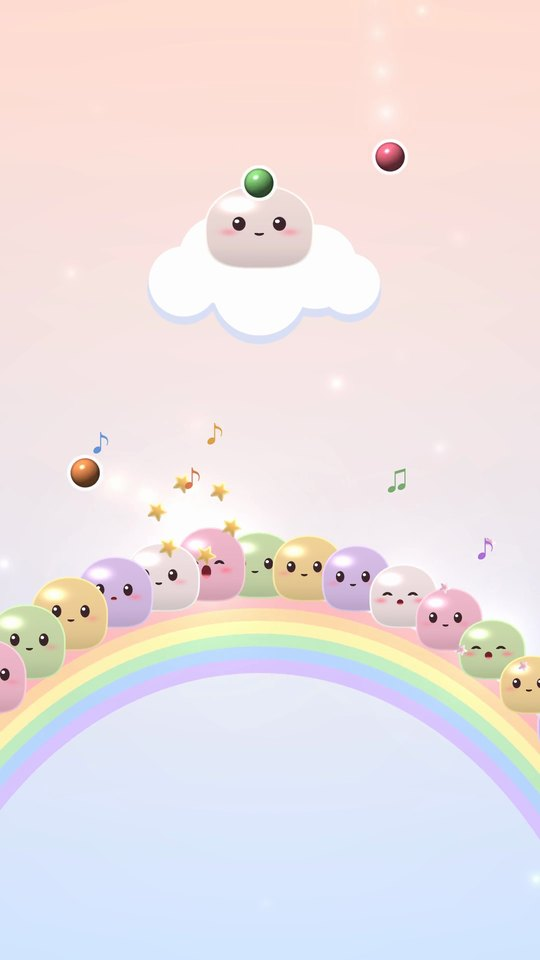
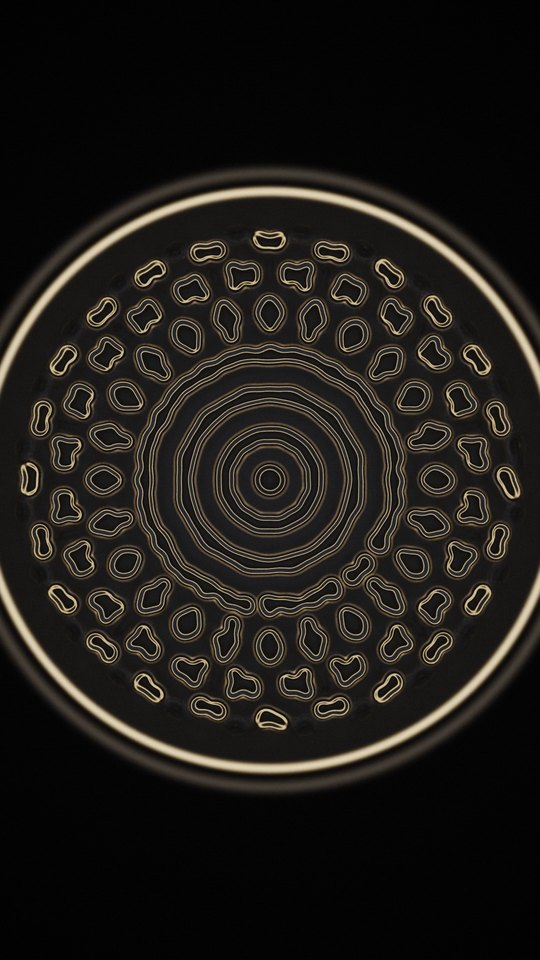
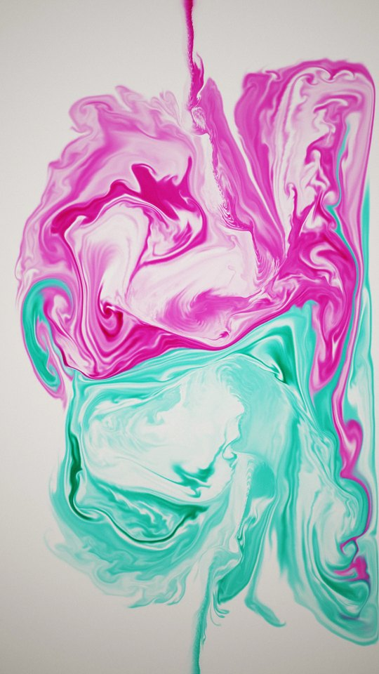

<p align="center"></p>

<h1 align="center">unreel()</h1>

<p align="center"><b>Films written in code, not filmed.</b><br>
Made by Claude Code · directed by <a href="https://instagram.com/nolimit">nolimit</a> / <a href="https://x.com/racewithai">racewithai</a></p>

Every frame here is computed: no camera, no hand animation, music synthesised in code. Each folder holds the complete
code for one film, plus notes on what is simulated, what is guided and what is only display. Films are added one at a
time.

| | Film | What it is |
|---|---|---|
|  | [**The Mochi Choir**](mochi-choir/) | 25 mochi sing Bach's Prelude in C. Every note is a candy landing on a singer's head: 293 throws under real gravity, each solved and checked to land on its own singer exactly on the beat. |
|  | [**Cymatics**](cymatics/) | Sand on a vibrating plate and a dish of water, driven at exactly the notes you hear. One short score makes the music and every pattern. Halfway through, the score is edited live, and the sound and the sand change together. |
|  | [**Ink**](ink/) | Ink in water gathers into the 107 lines of GLSL that simulate it. One sign is flipped, the shader is recompiled from that text, and the ink rises. |

**Watch:** each film (1080x1920, with sound) is attached to its own [release](https://github.com/beingcognitive/unreelcode/releases).

## How it's made
- **The Mochi Choir's throws are solved, not animated.** Each candy's flight comes from exact ballistics under Earth
  gravity; only the faces, squish and camera are animation.
- **Cymatics' water mandala grows from a seeded pattern.** The plate, the sand and the rest of the water are simulated
  freely from the score, and the live score edits are executed, not pre-baked.
- **Ink's code-forming shot runs in reverse.** The code starts as ink, the simulation dissolves it, and the film plays
  that backwards. The retype of one line is a guided edit. Everything after it is a real forward simulation of the
  recompiled shader.
- Each film's README separates what is simulated, what is guided and what is only display, and lists its known flaws.
- The music is synthesised in code and checked by measurement (loudness, peaks, timing).

## Running the code
Python 3.11 on macOS (Apple Silicon), with ffmpeg on PATH. The fluid solver runs on the GPU through moderngl
(OpenGL 4.1).
```
python -m venv .venv && .venv/bin/pip install -r requirements.txt
cd ink && ../.venv/bin/python render.py hook     # see ink/README.md for the full build
```
Renders are cached in `cache/` and finished films are written to `out/` (both git-ignored).

`lib/` holds the physics, renderer and score shared by the films that throw things to music.

`media/avatar_selfportrait.py` draws the account's avatar, `( ^ ‿ ^ )`, in wet ink with the Ink film's solver.

Music: J. S. Bach, Prelude in C major, BWV 846 (public domain), synthesised in code.

Unofficial project, not affiliated with Anthropic.

## License
[MIT](LICENSE): use, remix and share the code freely, with the copyright notice kept.
