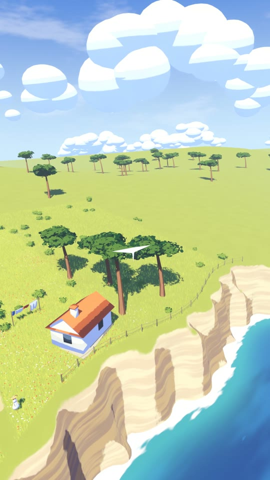
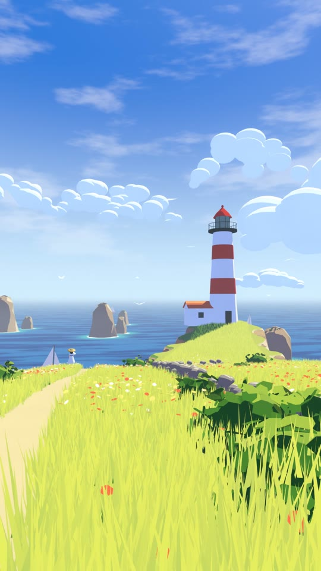
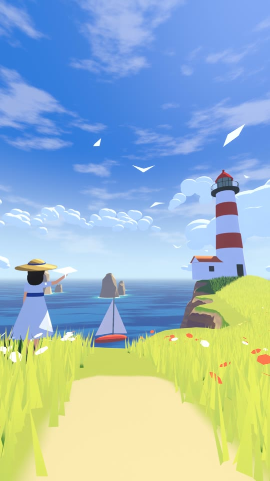
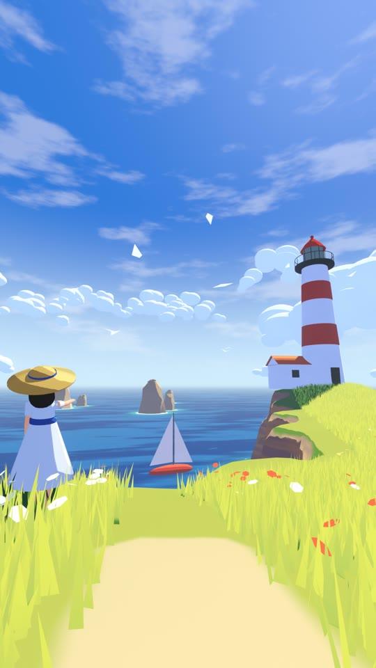
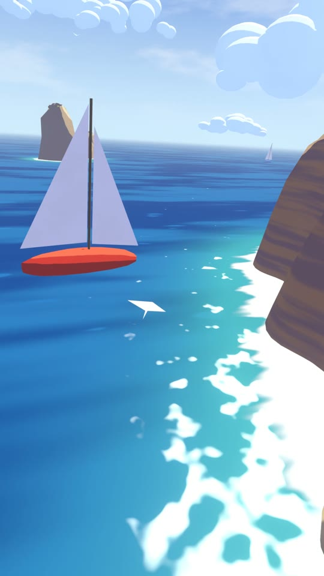
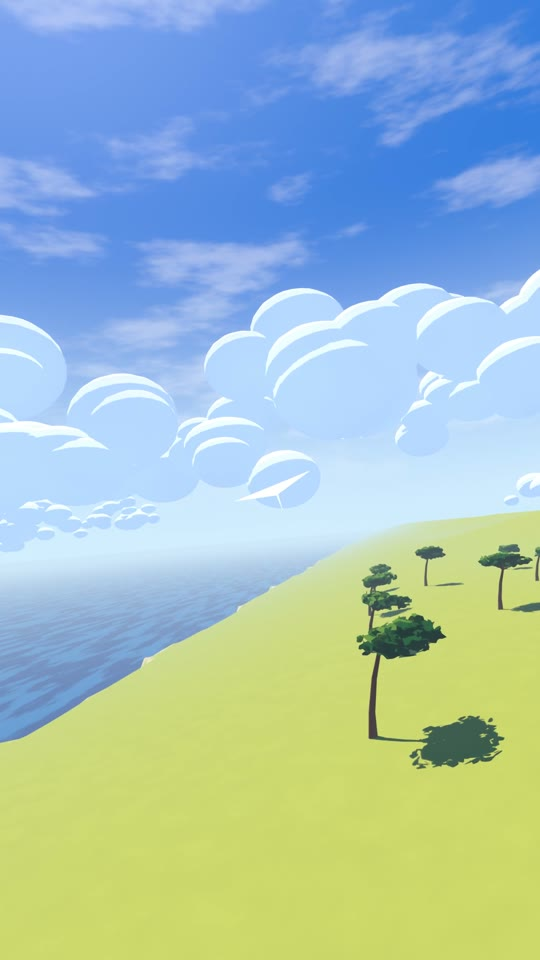
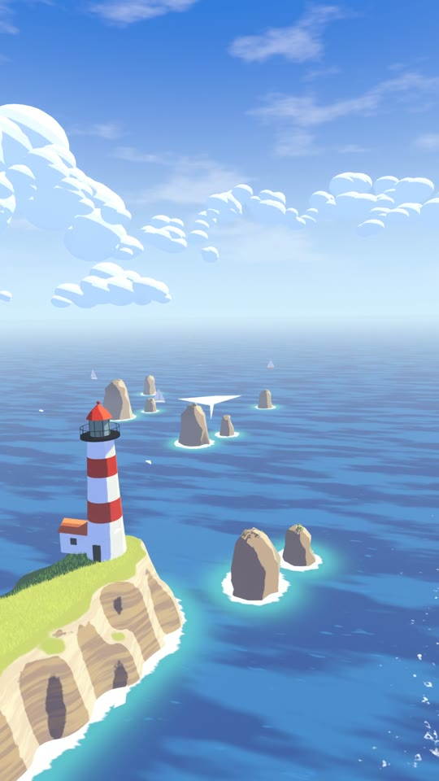
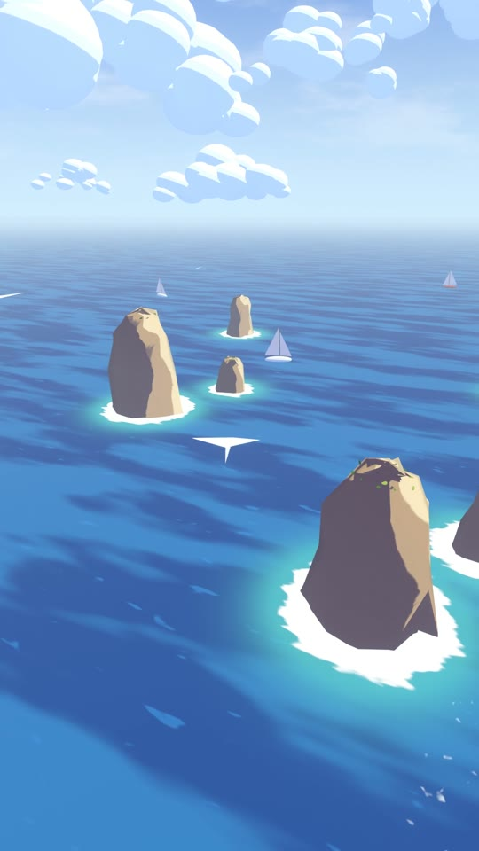

# A letter on the wind



A girl on a clifftop throws a paper plane, and the film follows it: down the cliff, round a lighthouse, back over the
meadow, out between sea stacks and up into the sky. **One Blender Python script builds every mesh, material and camera
move, and synthesises the music**; Blender's EEVEE renders the frames and ffmpeg encodes them. No models, textures,
images or sound samples are loaded.

**Watch:** [on Instagram](https://www.instagram.com/p/DfupzUKxps7/), [on YouTube](https://youtube.com/shorts/FjUaQiyQR7o), or download it from the [`a-letter-on-the-wind-v1` release](https://github.com/beingcognitive/unreelcode/releases/tag/a-letter-on-the-wind-v1):
45 s, 1080x1920 (9:16), 24 fps, with sound.

<br clear="right">

| | | | |
|---|---|---|---|
|  |  |  |  |
| 0:04 the meadow | 0:12 the letter | 0:14 the throw | 0:16 off the cliff |
|  |  |  |  |
| 0:21 over the cottage | 0:26 the hill | 0:29 the lighthouse | 0:35 the sea stacks |

## The film
| Time | What happens |
|---|---|
| 0–9.6 | Fade in. The camera moves up a path through a flowering meadow toward a girl at the cliff edge; a striped lighthouse stands on the headland beyond |
| 9.6–15.0 | Behind her. She raises a paper plane, draws her arm back and throws at 14.3; the plane leaves over the edge |
| 15.0–19 | The camera follows the plane from behind: down the cliff face, low over the foam, past a sailing boat |
| 19–25 | Round the tip of the headland, up past the lighthouse, and back inland over the cottage and its washing line |
| 25–30 | Over the pine hill, a wide turn, and out to sea above the lighthouse |
| 30–40 | Down between the sea stacks and low over the water, past a second boat |
| 40–45 | The plane climbs and pulls away; the camera lets it go and tilts up into sky and cloud. End credits; fade to white |

Times after 15 s are read from stills about 3 s apart, so they are approximate.

## How it's made
Everything is in [`make_anime_coast_vertical.py`](make_anime_coast_vertical.py), about 860 lines, run inside Blender.
It uses Blender's bundled Python and numpy and nothing else. Run with no arguments it starts four Blender worker
processes, each rendering a quarter of the frames to PNG, writes the soundtrack to a WAV file, and calls ffmpeg.

**The scene.** A headland above the sea, built from formulas: the coastline is a wavy line plus a tapering promontory,
and the ground height is a plateau that falls to the water over a few metres of noisy cliff. On it stand a lighthouse
and a cottage (lathed profiles and boxes), a dry-stone wall (small ellipsoids along a curve), a rope fence, a washing
line, about 70 pines, bushes, and ten sea stacks. The meadow is 332,266 grass blades, each one triangle, and drifts of
flowers drawn as small six-sided dabs. The whole scene is 83 mesh objects and about 821,000 polygons.

**The toon shading** is one node recipe shared by almost every material. A white diffuse shader is converted to a
colour (Shader to RGB), its brightness is divided by the brightness of a fully lit surface, and that number picks one
of three hand-chosen colours: shadow, mid and light. The steps between them are nearly hard, so surfaces read as flat
bands with a hand-drawn animation look. A little noise shifts where the bands fall, the light's colour tints the
result, and distance haze is mixed in inside the material. Foliage and grass are lit with a stored "clump" normal
instead of their own, so a tree shades as one mass and not as thousands of separate leaves.

**The character** is assembled from lathes, tubes and ellipsoids: dress, head, hair, straw hat, arms in two segments.
She is posed through empties at the body, head, shoulders and elbows. The throw is five hand-set arm poses (hold,
raise, wind up, throw, rest) blended with smoothstep.

**Clouds and sea.** The clouds are 46 heaps of ellipsoids with the same three-band shading, over a painted sky with a
second layer of noise wisps. The sea is a flat plane with no waves in the geometry: its colour comes from two drifting
noise patterns, turquoise near land, and foam where a stored distance-to-shore value plus noise crosses a threshold.

**The camera** has three set-ups: a push up the path, a fixed view behind the girl, and a chase. The plane's route is
a Catmull-Rom curve through 30 hand-placed points, re-parametrised by arc length; the chase camera rides the same
curve a few metres behind, looks at the plane, and rolls with its turns. In the last eight seconds the gap widens from
4.2 m to 26 m and the aim lifts.

**The motion** is set per frame by a function of time; there are no keyframes. The washing swings as a pendulum sheet
with a travelling ripple, 16 gulls circle on fixed radii with flapping wing tips, and six boats drift and rock.

**Finishing** in Blender's compositor: a light Kuwahara filter (2.4 px) to soften edges, bloom, exposure and the fades.

**The music** is synthesised in the same script at 44.1 kHz stereo: sine pads on D, B minor, G, A at four seconds a
chord, a sine bass, and a plucked arpeggio in eighth notes, with every other note an octave higher while the plane is flying. Wind and
sea are white noise band-limited with an FFT, with a swell of wind at the throw. The mix goes through a tanh soft
clipper and is scaled to a peak of 0.7.

**Chosen, not simulated:** all of it. The plane does not obey aerodynamics; it follows the drawn curve at a set pace
and banks by the curve's bend. Wind, cloth, water and birds are formulas chosen to look right. The colours are picked
by hand for one fixed time of day.

**Simplifications:**
- **The sea is flat.** There is no swell, no reflection of the land, and the foam does not move with waves.
- **Clouds are solid.** They are opaque ellipsoids; the plane never flies through one.
- **Nothing collides.** The route was drawn by hand to miss the cliff, the lighthouse, the masts and the stacks.
- **The girl does not walk,** and has no fingers or facial animation. She is seen from behind and from far away.
- **Shadows** come from one sun, with the shadow distance set to 160 m.

## Build
Blender and ffmpeg; nothing to install. Built with Blender 5.1.2 and ffmpeg 9.0.1 on macOS (Apple M3 Pro).
```
/Applications/Blender.app/Contents/MacOS/Blender -b --factory-startup --python make_anime_coast_vertical.py
        # -> anime-short-coast-vertical.mp4 next to the script, about 11 minutes
/Applications/Blender.app/Contents/MacOS/Blender -b --factory-startup --python make_anime_coast_vertical.py -- --stills 12.5,21,35 out 0.5
        # PNG stills at those times, at half size
/Applications/Blender.app/Contents/MacOS/Blender -b --factory-startup --python make_anime_coast_vertical.py -- --audio out.wav
        # the soundtrack only
```
On other systems replace the path with your Blender binary; `ffmpeg` must be on PATH. Encoding is libx264
(`-preset slow -crf 18`) and AAC at 192 kb/s.

**The end credits** are not drawn by this script. It renders the film with an empty sky from 40 s, and
[`credits.py`](credits.py) (Python with Pillow, the Avenir Next system font) lays three lines of navy text with a soft
white halo over that sky from 40.4 s to 44.3 s:
```
/Applications/Blender.app/Contents/MacOS/Blender -b --factory-startup --python make_anime_coast_vertical.py -- --range 960 1080 tail
python credits.py anime-short-coast-vertical.mp4 tail a-letter-on-the-wind.mp4
```
The posted and released file was made this way from the earlier render that still had a title: its last five seconds
(frames 960 to 1079) were re-rendered without the title and joined to the first 40 s, and the picture was re-encoded
(`-crf 16`) with the sound copied unchanged. It is 38.3 MB. One frame before the join (frame 962) matched the earlier
render at 40.9 dB PSNR. `SHOW_TITLE = True` near the top of the script restores the on-screen title the film had
before the credits replaced it.

## Measured
From the script's output before the credits were added, with ffprobe and ffmpeg:
- **Duration** 45.000 s, 1,080 frames, H.264 + AAC stereo at 44.1 kHz, 31.5 MB.
- **Render time** 655 s for the full film (four workers, 20 EEVEE samples per frame), encoding included.
- **Sound level** after AAC encoding: peak −3.2 dB, RMS −16.4 dB (ffmpeg astats).
- **Scene size** 83 mesh objects, 820,828 polygons, 30 materials (counted in Blender after the build).
- **Title switch:** with the title off, a frame re-rendered at 20 s matched the same frame of the encoded film at
  42.0 dB PSNR, and a frame at 42 s showed no title. That is one frame each, not the whole film.

Not measured: whether two runs give a byte-identical file.

## Known flaws
- **Claude has not watched it move or heard it.** The picture was checked through extracted stills and the sound
  through level measurements only. The director watched each cut and approved this one.
- **The cloud heaps show their spheres,** most of all from below near the end.
- **The plane is small** in the frame for much of the flight over open water.
- **In the throw shot the bare path fills the bottom third** of the vertical frame.
- **The cottage and washing line are barely seen:** the vertical frame is too narrow for them in the opening, so they
  appear only from the air.
- **Unused code remains:** the sky still has stars, a sun disc and a lamp glow from an earlier ending at night, all
  switched off.
- **File names still say `anime-short-coast`,** the working name.

## Versions
The director's notes shaped every cut; these are the main turns.
- **First scene:** a misty forest with a mossy stone guardian, 37 s, landscape. Dropped for being too close to a
  reference picture; only the paper plane was kept.
- **The headland:** new setting, 37 s, with a sunset and a night ending under the lighthouse beam.
- **One minute:** the flight grew from 9 s to 30 s, back over the land and out between sea stacks. The launch was
  reshot from behind the girl.
- **Daylight only:** the sunset and night were removed and a redundant second launch shot cut. The shading changed from
  a soft painted filter to hard three-band toon shading. Ink outlines were tried and removed: at these sizes they made
  the girl and the stone wall look heavy.
- **This cut** (15 Nov): vertical, 45 s, each shot reframed for 9:16, and the on-screen title replaced by end credits.

---
Made by Claude Code, Fable 5.2 · directed by being.cognitive. Part of [unreel()](../): films written in code, not filmed.
