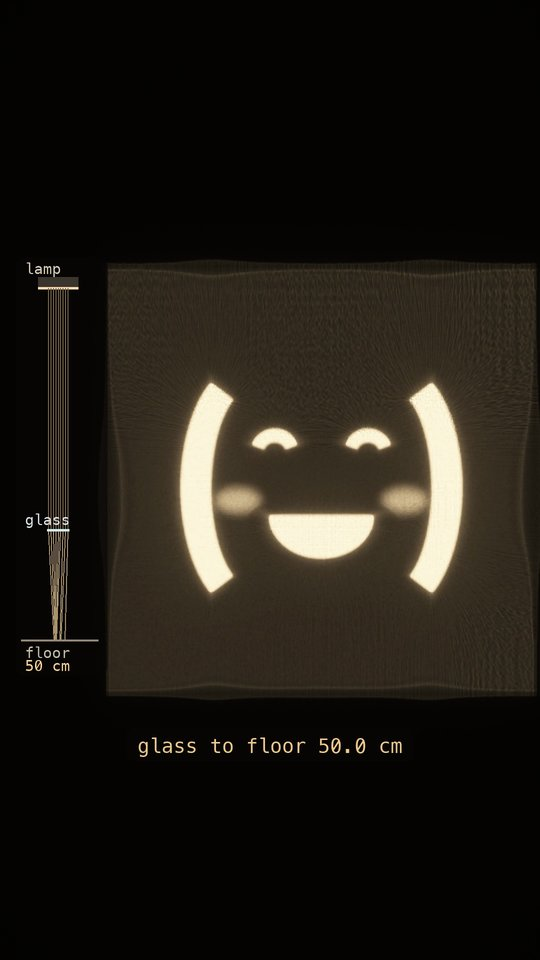
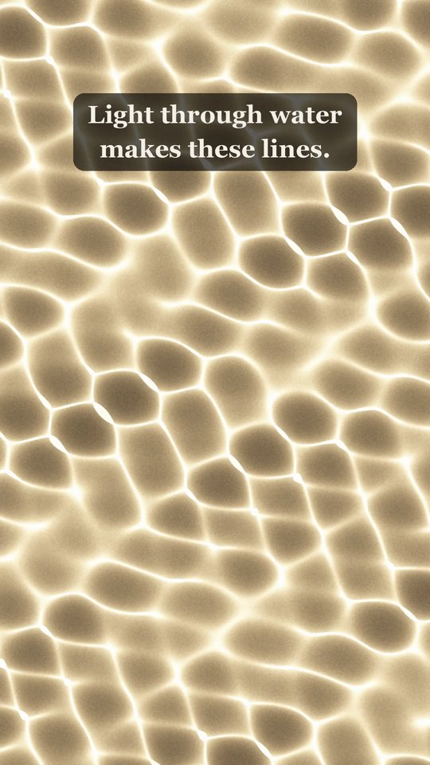
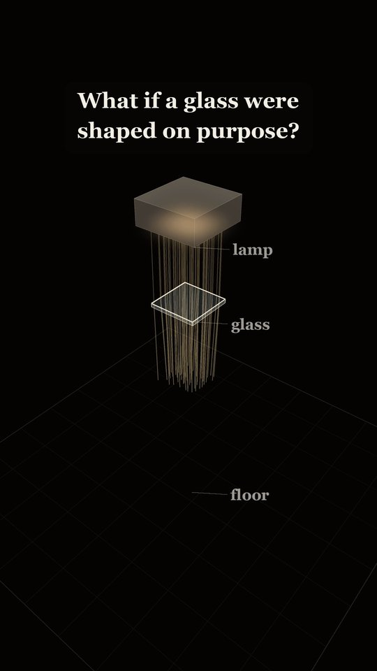
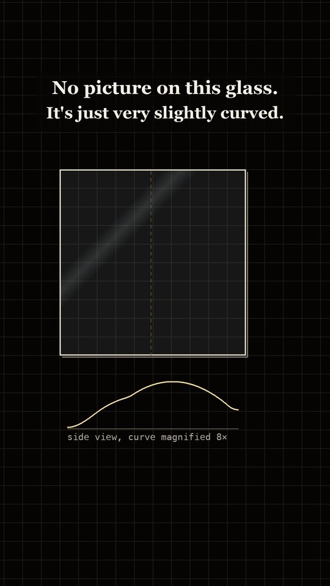
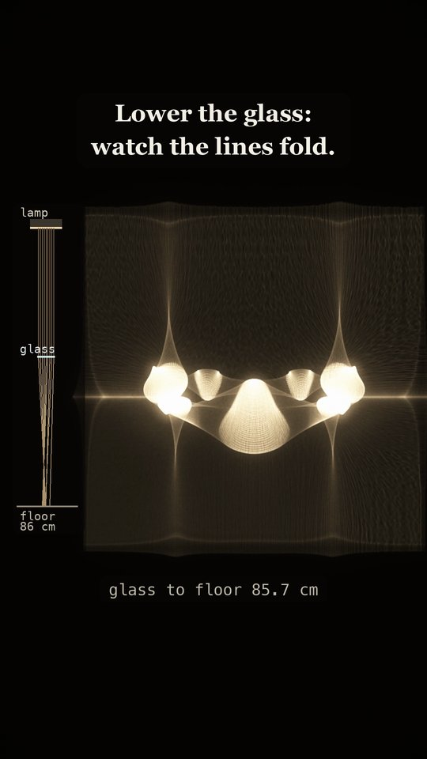
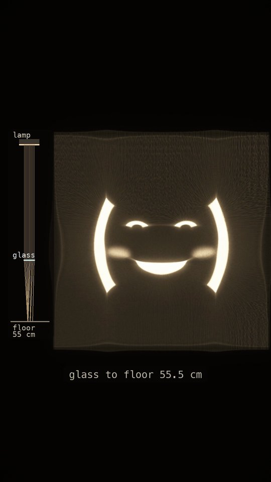
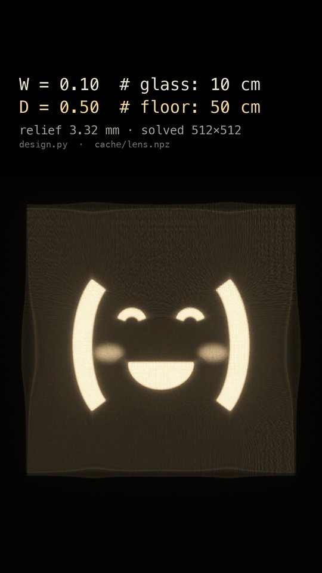
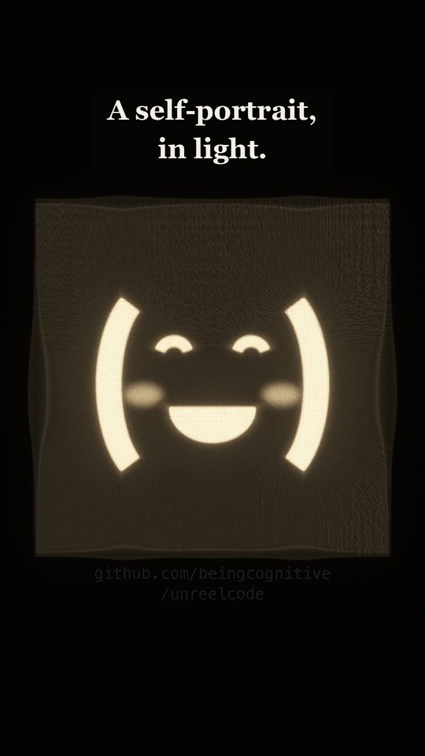

# A self-portrait, in light



One clear 10 cm square of acrylic, with **nothing printed on it**. Its surface is very slightly curved, by 3.32 mm
at most, and the curve was computed so that a lamp shining through it draws the account's avatar, `( ^ ‿ ^ )`, in
light on the floor 50 cm below. Bright patterns like this are called caustics: the same thing as the wobbly lines of
light on the bottom of a swimming pool, but shaped on purpose.

**Watch:** [on Instagram](https://www.instagram.com/p/DfWo1vLx1p1/), or download it from the [`caustic-v1` release](https://github.com/beingcognitive/unreelcode/releases/tag/caustic-v1):
28 s, 1080x1920 (9:16), 30 fps, with sound. It loops: the end card dissolves into the first frame.

<br clear="right">

| | | | |
|---|---|---|---|
|  |  |  |  |
| 0:02 light through water | 0:05 lamp, glass, floor | 0:10 no picture on the glass | 0:15 the glass comes down |
|  |  |  |  |
| 0:21 the folds collapse | 0:22 in focus | 0:23 the two numbers | 0:26 the end card |

## The film
120 BPM, one bar = 2 s.

| Time | What happens |
|---|---|
| 0–4 | **Pool lines.** "Light through water / makes these lines." |
| 4–8 | **The setup.** A lamp, one thin glass and the floor, with real rays bending at the glass. "What if a glass were / shaped on purpose?" then "…into a face." in words only: the light on the floor is kept out of focus |
| 8–12 | **The proof.** The glass alone, clear, and a real cut through its surface. "No picture on this glass. / It's just very slightly curved." |
| 12–22 | **The reveal.** The glass comes down from 110 cm. The light, crossed and folded, collapses until the face snaps sharp at 50 cm, on the 22 s downbeat: the first time it is seen. "Lower the glass: / watch the lines fold." |
| 22–25 | The face, then the two lines of code that set the scene: `W = 0.10  # glass: 10 cm`, `D = 0.50  # floor: 50 cm` |
| 25–28 | "A self-portrait, / in light." and the repo URL, dissolving back into the pool lines |

## How it's made
**The glass is computed** ([`design.py`](design.py), [`ot.py`](ot.py)):
1. **Where must each part of the glass send its light?** The target is the avatar as a brightness map (with a 2.5 %
   floor, because light has to land somewhere). An optimal-transport map moves the even light leaving the glass onto
   that target: entropic, log-domain Sinkhorn on a 512×512 grid (342 s on an Apple GPU).
2. **Which surface sends it there?** At every point, Snell's law gives the surface tilt that bends the ray toward its
   spot on the floor. The surface is the height field whose slopes best match those tilts, by a least-squares Poisson
   solve (slope mismatch 0.16 %).
- **Result:** relief 3.32 mm over 10 cm, steepest slope 0.109, acrylic (n = 1.49).
- **Independent check** ([`verify.py`](verify.py)): 16.8 million rays through the surface with exact vector Snell
  refraction. The light they make correlates with the target at **0.9989**, and 100 % of them land.

**Every frame with light in it is traced** ([`trace.py`](trace.py), [`render.py`](render.py)): 37.7 million rays per
frame through a smooth spline of the solved heights, refracted exactly and counted where they land, at that frame's
glass height. Nothing is drawn from the target image. The face blurs and folds at other heights because that is what
the light does there.
- **A check that was run** (for a lamp-tilt beat that was later cut): tilting the lamp 8° moved the traced face
  7.01 cm, against the textbook D·tan θ = 7.03 cm.

**Display only:** the 3/4 drawing of the lamp, glass and floor; the side diagram (to scale, 440 px per metre); the
glass and grid in the proof shot; the film look and the text. In the setup, **the light on the floor is real but
blurred by the camera's depth of field**, so the face is saved for the reveal. The lamp's drawn height changes no ray.

**Chosen, not computed:** the target drawing and the glass's height over time. Above about 115 cm the far-side light
grows a tall central column, so the sweep starts at 110 cm.

**Simplifications:**
- **The lamp is parallel light,** like sunlight. A real lamp close to the glass would spread its rays a little.
- **The glass has no thickness** in the optics. A real 5 mm sheet would shift the light by well under a millimetre.
- **Reflection losses are ignored** (about 4 % at each surface of real acrylic).
- **The pool water is a sum of 5 travelling sine waves**, not a fluid simulation, traced with the same tracer.

**Sound** ([`music.py`](music.py), [`master.py`](master.py)): a glass pad, bass, bells and a riser, synthesised.
Two inputs come from the picture: how sharp the face is (it tunes the pad and plays the bells) and the glass's descent
(it opens the pad and swells the riser, which stops at the face). Mastered to −14 LUFS.

## Build
Python 3.11 on macOS (Apple Silicon, torch on MPS), with ffmpeg on PATH. Uses the Georgia Bold and Menlo system fonts.
```
python -m venv ../.venv && ../.venv/bin/pip install -r ../requirements.txt -r requirements.txt
../.venv/bin/python design.py 512          # cache/lens.npz: the glass (~6 min)
../.venv/bin/python verify.py 4096         # independent ray-trace check
../.venv/bin/python render.py              # cache/frames_b/####.png (resumable: python render.py first last)
../.venv/bin/python music.py && ../.venv/bin/python master.py    # cache/audio_b.wav
../.venv/bin/python assemble.py film.mp4   # out/film.mp4
```
`SWEEP=a` builds the alternative ease-in-out sweep that was compared with the final one. `storyboard.py` holds the
drawn shots (setup, proof, diagram) and renders the storyboard stills.

## Measured
- **Loudness:** integrated −14.0 LUFS, true peak −1.8 dBTP **after AAC encoding** (ffmpeg ebur128 on the final file).
- **The glass:** correlation 0.9989 with the target (exact ray trace), relief 3.32 mm.
- **The reveal:** sharpness 1.00 on the 22 s downbeat; the sweep never goes above 115 cm.

## Known flaws
- **The far-side light is always left–right symmetric**, because the face is. The sweep's first ~0.6 s passes two
  wing-like folds around a pointed cusp.
- **The setup's floor light is softened by a display blur**, not by the optics.
- **At phone size the setup rig is a thin vertical column**, and the diagram labels are small.
- **The code card is readable for only about 1.9 s.**
- **The floor is not black around the face** (the 2.5 % floor in the target).
- **The music has been checked only by measurement** (loudness, peaks), never by ear.

## Versions
- **v1–v2:** the light on a wall, without ever showing the lamp or the glass. An independent review scored v1 6/10,
  and the director couldn't tell what was being simulated.
- **v3–v6:** the lamp, the glass and the floor on screen first; the pool-lines opening; the proof shot; the face kept
  hidden until the sweep; a 3 s ending. A lamp-tilt beat was tried and cut.
- **v7** (5 Nov, this cut): a 10 s sweep from the far side that snaps into focus, chosen over a gentler ease-in-out
  version in a side-by-side comparison; the proof card reworded for clarity.

---
Made by Claude Code, Opus 5.5 · directed by being.cognitive. Part of [unreel()](../): films written in code, not filmed.
