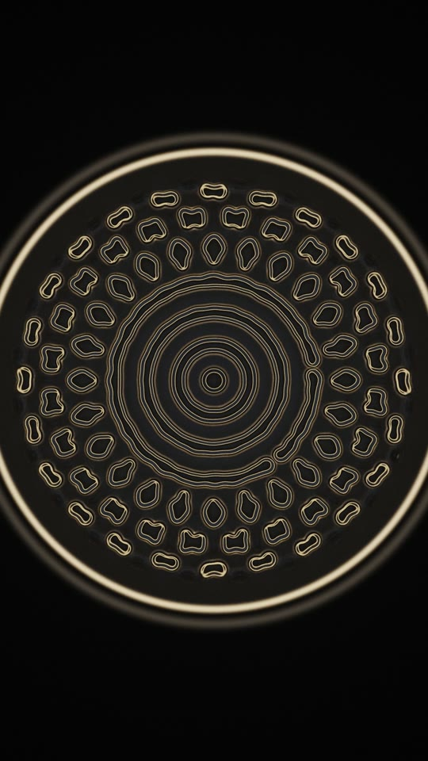
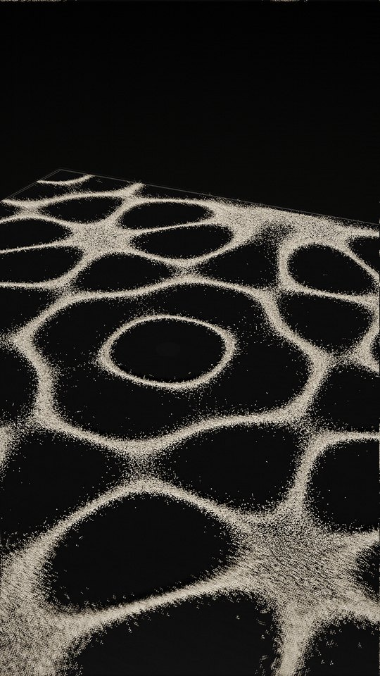
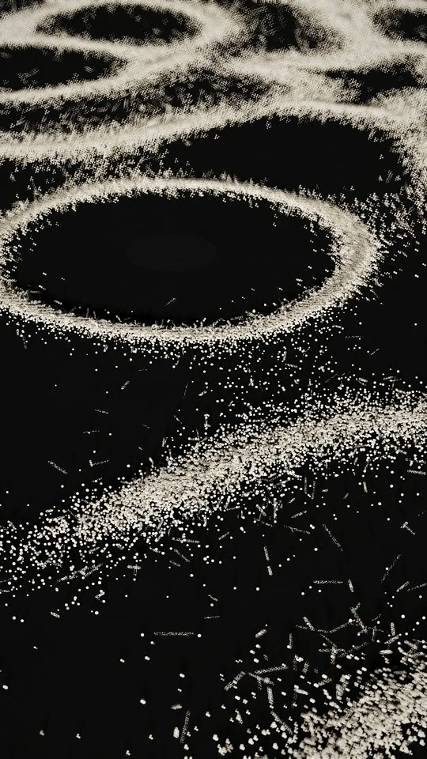
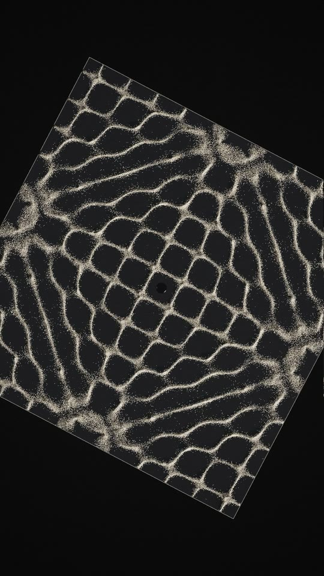
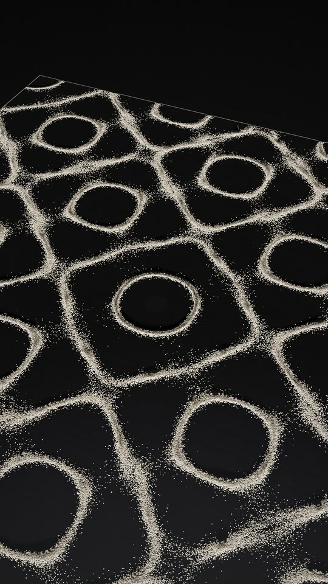
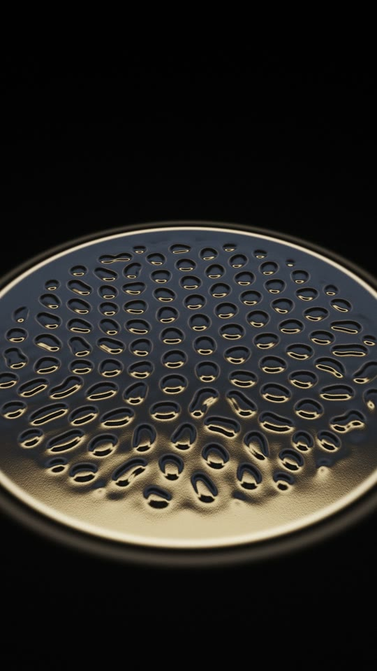
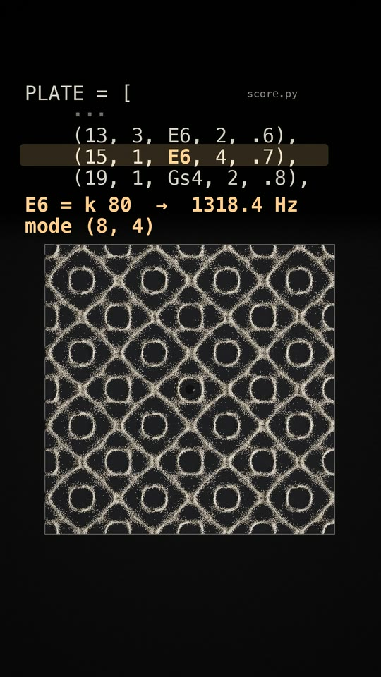
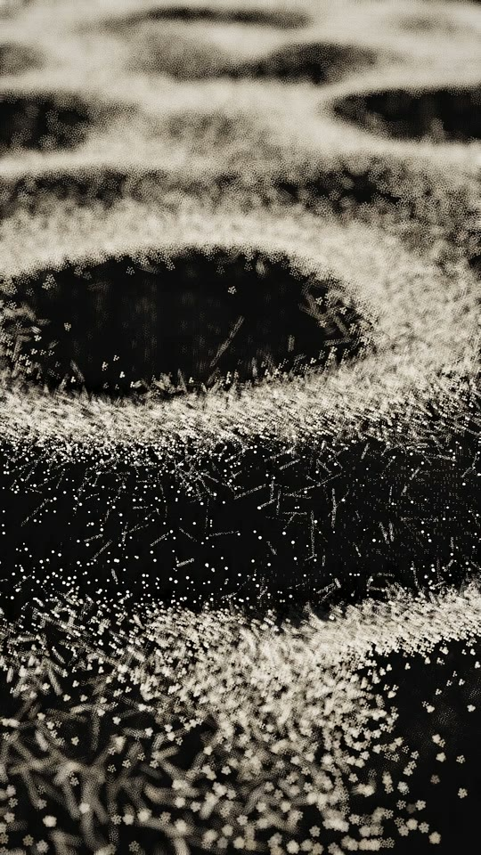
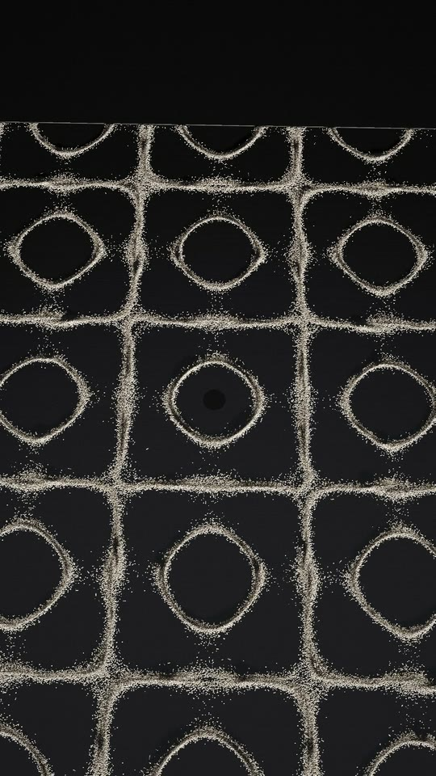

# Cymatics: you are seeing the song



Sand on a black metal plate, and a dish of water. Every pitch you hear is a vibration mode of the plate, so each
note sorts a million grains into its own figure, and the same song makes the water ripple into cells and rings.
Halfway through, the film shows the score it is playing, edits one note three times, and each edit changes the
next bar's pitch and the sand's figure together.

**Watch:** [`cymatics-v1` release](https://github.com/beingcognitive/unreelcode/releases/tag/cymatics-v1): 56.8 s,
1080x1920 (9:16), 30 fps, with sound. It loops: the last half second dissolves into the first frame.

One file, [`score.py`](score.py) (74 lines), is the only source of every pitch you hear and every pattern you
see. The pictures don't react to the audio: sound and picture are computed separately, from the same note list and
the same frequencies.

<br clear="right">

| | | | |
|---|---|---|---|
|  |  |  |  |
| 0:01 the first strike | 0:05 grains hop onto a ridge | 0:08 B5 from above | 0:21 the rest: the figure holds |
|  |  |  |  |
| 0:24 Faraday cells in water | 0:36 one note edited | 0:43 the motif returns | 0:51 E5, the last figure |

## The film
96 BPM in 4/4, so one bar is 2.5 s. Times are film time. The film opens 22 frames (0.73 s) after the first strike,
when the first figure has formed, and bar 10 (2.5 s of a still-flat dish) is cut from picture and sound together,
on its bar lines.

| Time | Picture | On screen | Music |
|---|---|---|---|
| 0–4.8 | **Strike.** A black anodised plate from a high three-quarter view. The first downbeat, G#4 = k 25, drives modes (4,3) and (5,0), and the sand has just leapt into a ring-and-petal figure | "Sound on. / This sand is listening." then "simulated, not filmed" | Struck and bowed metal G#4 ringing, then E5 |
| 4.8–7.3 | **Macro,** from just above the sand. Grains hop, motion-streaked, and climb onto a new ridge: C#5 = (5,3) | | C#5; a glass pad enters on E3 |
| 7.3–9.8 | **Top-down,** turning slowly. B5 = (6,5), the most intricate figure so far | | B5 |
| 9.8–14.8 | **Back-lit travel.** A three-quarter camera glides across the plate while a half-note melody changes the figure every 1.25 s | | E – C#m; E5 G#5 C#6 B5 |
| 14.8–19.8 | **High orbit** over the whole plate | | A – Bsus; A5 E5 F#5 |
| 19.8–22.3 | **Rest.** The motionless figure, well lit from a high three-quarter view, with a slow push-in | | Near silence: only the reverb tail |
| 22.3–27.8 | **Water.** A 60 mm dish from above, Faraday cells already forming, then an oblique glide over the glossy cells | "The same song, / now in water." | The glass pad on E3 + E4, then E3 + G#4, a bass drone |
| 27.8–32.3 | **Climax.** A centred mandala of rings blooms in the water | | A/E at full level, bells C#6 and E6: the loudest section |
| 32.3–42.3 | **The turn.** The plate from above, three quarters of the frame wide, pushing in slowly. A caption, then the PLATE lines of `score.py` appear above it. The bar-15 line plays, then is edited live three times, `E5 → E6 → A5 → G#4`: about half a second before each bar line the cursor deletes the old note and types the new one, while the old readout dims; the last character lands exactly on the bar line, the frame the new pitch sounds, the readout `k → Hz → mode` switches and the sand starts to re-form | "This is the score. / Watch me edit it." (above the plate, before the code appears) | A soft I–vi–IV–V under the looped bar: E5, E6 (an octave up, figure twice as fine), A5, and G#4, the opening note |
| 42.3–52.4 | **Finale.** A macro on the sand, then a crane up to the whole plate. The motif returns and resolves to E5 = (6,2), circles in squares | | Full E major; the last bell rings out |
| 52.4–56.8 | **End card** over the plate at half brightness, the camera still dollying in slowly. The text fades out, then the last half second dissolves into the first frame | "You were seeing / the song." / "1,000,000 grains · one 74-line score" / `github.com/beingcognitive/unreelcode` | A quiet E-major pad holds and crossfades into the opening |

## How it's made
**The idea that shaped the piece:** in this plate model every note is a plate mode. Mode (a, b) rings at
`f = F·(a² + b²)` with F = 16.48 Hz, so the piece can only use pitches whose k = a² + b² is a sum of two squares.
A 3:2 ratio would need 3k/2 to be a sum of two squares too, and it never is: **this plate has no perfect fifth.**
The nearest, B = k 61 over E = k 40, is 30 cents sharp, and the music is written in that scale. (A property of the
idealised model, not of every real plate.)

**Simulated** — the plate ([`plate.py`](plate.py)):
- Modes `φ_ab = cos(aπx)cos(bπy) + cos(bπx)cos(aπy)` on [−1, 1]², 135 modes (a, b ≤ 15): the classic sum-of-cosines
  Chladni form, a membrane-like approximation of a free plate, not an exact eigen-solve.
- The plate is driven at exactly the frequency you hear (1:1 in Hz), at its centre, with a steady-state modal response
  and 0.1% damping. Notes sounding together add in energy.
- 1,000,000 sand grains. A resting grain launches when the plate's acceleration exceeds g, flies ballistically under
  real gravity, and lands. Grains on nodal lines never launch, so the sand collects there. The launch envelope is the
  same function the synthesiser uses, so the sand jumps on every strike and calms in the bowed sustain.

**Simulated** — the water ([`water.py`](water.py)):
- A 60 mm dish, 4 mm deep, on a 1024² pseudo-spectral grid. Each note of the glass voice makes its own Faraday ring
  unstable at f/2, with the wavelength from the real capillary-gravity dispersion of water (E3 = 164.8 Hz gives
  λ = 4.15 mm). A Swift–Hohenberg-type amplitude equation evolves the surface.

**Tuned, not derived:** the sand's launch threshold, kick sizes and random spread (chosen so a figure forms in about
0.5–1.5 s, as in real demonstrations), and the water equation's coefficients.

**Art-directed (disclosed):** at bars 12 and 13 a centred 8-fold, then 12-fold, symmetric seed is blended into the
water, growing from the centre over 1.2 s. Without it the hexagon lattice always won and no mandala appeared. After
the seed the equation evolves freely. The water is also shown stroboscopically (frozen phase, with a gentle display-only
breathing of its amplitude).

**Heard but driving nothing:** the bass drone and three sub thumps.

**The live edit is real.** The code panel draws actual lines of `score.py` (the PLATE lines around the edited one,
untruncated, at a 56 px font), and the three edits are the same string replacements that [`timeline.py`](timeline.py) executes (`exec`) to produce bars 16–18 of the audio
and the plate drive. Nothing in the edit is pre-baked.

**Rendering:** every grain is drawn individually (shadow-mapped key light, facet glints, motion streaks for flying
grains, depth of field, film grain), in [`render_plate.py`](render_plate.py). The water is ray-traced per pixel to first
order (reflection of a ring light, Fresnel, caustics on the dish floor), in [`render_water.py`](render_water.py).
Captions and the end card are typeset by [`overlay.py`](overlay.py). [`splice.py`](splice.py) cuts the master to the
film's timing: it opens 22 frames after the first strike and removes bar 10 on its bar lines (80 ms crossfade).

**Music** ([`audio.py`](audio.py), numpy only, no samples): a struck-then-bowed plate voice with inharmonic partials, a
glass pad, a sine bass, and a synthetic 3.2 s reverb. [`master.py`](master.py) normalises to −14 LUFS with a 4×
oversampled look-ahead limiter.

## Build
Python 3.11 on macOS (Apple Silicon: the simulations use PyTorch on the GPU via MPS), with ffmpeg on PATH. Needs
`torch` and `soundfile` in addition to the repo's `requirements.txt` (see [`requirements.txt`](requirements.txt) here).
```
python -m venv ../.venv && ../.venv/bin/pip install -r ../requirements.txt -r requirements.txt
mkdir -p cache out dev
../.venv/bin/python audio.py && ../.venv/bin/python master.py     # out/audio.wav
../.venv/bin/python run_plate.py sim                              # sand checkpoints at each shot start
for s in s1 s2 s3 s4 s5 s6 c1 f1; do ../.venv/bin/python run_plate.py shot $s; done
../.venv/bin/python render_water.py run                           # the water shots
PY=../.venv/bin/python ./assemble.sh                              # splice the audio, out/film.mp4, loudness and peak
```

## Measured
- **Loudness:** integrated −14.0 LUFS, true peak −2.4 dBTP, loudness range 6.2 LU, **after AAC encoding** (ffmpeg
  ebur128 on the final file). No dead air: the closing pad sits around −27 dBFS and crossfades into the opening.
- **Edit sync, frame by frame:** at each of the three bar lines the finished token and the readout switch on the
  same frame the new note starts; the sand's change between frames jumps on the next frame (33 ms later: at the
  instant of the strike no grain has moved yet). Before the bar line the readout is dimmed while the note is retyped.
- **Pitch = drive:** the plate is driven at exactly the frequencies you hear. FFT peaks of the master at each plate
  onset (412.0, 659.2, 560.5, 1005.2, 659.2, 1318.2, 873.0 and 412.0 Hz) match the score's values to within 0.4 Hz.
- **Frames:** 1,703 at 30 fps (56.8 s). No blank frames: every frame was checked, and the lowest luminance spread is
  at the end-card dim.
- **Readability:** the code is Menlo at 56 px (capital height 41 px); the URL on the end card is Menlo 40, inside the
  safe zone.
- **Compute:** the final pass took about 9 minutes on an M3 Pro: sand checkpoints 191 s, the eight plate shots
  about 270 s, the water 95 s.
- **Code:** `score.py` is 74 lines; the whole film is 1,193 non-blank lines of Python and shell.

## Known flaws
- **At half-note speed the figures are still migrating** when the next note arrives (10–20 s and the finale), so they
  read as a mix of two figures. Bar-long notes form cleanly.
- **Sand in low-amplitude regions stays unsorted,** visible as fuzzy patches near the plate edges for some notes.
- **The water mandala needed an art-directed seed** (see above), and the 8-fold bloom at bar 12 mostly reads as a
  disordered transition. The mandala decays back toward cells just before the cut to the score.
- **The film opens mid-strike.** It starts 0.73 s after the first strike, so the first thing heard is the note's
  ring, not its attack.
- **The turn's holds move slowly:** once a figure has formed, the motion is the plate's slow push-in.
- **The water rendering** has no true refraction of the floor image and first-order caustics only.
- **The music has been checked only by measurement** (loudness, peaks, and FFT peaks against the score), never by ear.

## Versions
- **v1** (1 Nov): 60 s landscape 2.39:1.
- **v2** (2 Nov, after an independent review): the 0.5 s pickup (flat sand and an air swell) cut, so the film opens on the bar-1 strike.
- **v3** (3 Nov, this cut): native vertical 1080x1920 with every camera re-framed; the weakest shot (a dark low slide)
  replaced by a back-lit three-quarter travel; `score.py` reformatted to 40 columns (same notes, verified identical
  events) so the live edit reads on a phone untruncated; captions in the series' style; the repo URL on the end card;
  a looping ending.
- **v3.1** (4 Nov, after an independent blind Reels review of v3: 7.5/10): frame 0 is the formed first figure (the
  film and its audio open 22 frames after the strike); bar 10, a still-flat dish, cut from picture and sound on its
  bar lines; the turn rebuilt for feed size (the code from 36 px to 56 px, only the PLATE lines, a cursor that
  deletes and retypes each note with a flash, the plate kept above the caption overlay, a slow push-in and turn, no
  dark gap); a two-line end card with a 40 px URL over a slowly turning lattice; a slow turn on the top-down B5 shot;
  dither against banding in the water.
- **v3.2** (4 Nov, after a second independent blind review of v3.1: 7/10): each edit now lands exactly on its bar line
  (typing starts about half a second before; the readout switches with the note and is dimmed while the code and it
  disagree); the rest bar is a well-lit high three-quarter view instead of a dark macro; the turn's plate is three
  quarters of the frame wide, with the caption above it rather than on the sand; the end card over a half-bright
  plate, centred, with the URL in cream on two lines; the text fades out before the loop dissolve; the glass pad holds
  quietly to the end and crossfades into the opening (no dead air); a higher, sharper macro; the finale's crane ends
  closer, so no dark wedges at the plate's corners; a depth-of-field sampling fix that removes specks along the top
  edge; a larger "simulated, not filmed".

---
Made by Claude Code, Opus 5.5 · directed by being.cognitive. Part of [unreel()](../): films written in code, not filmed.
