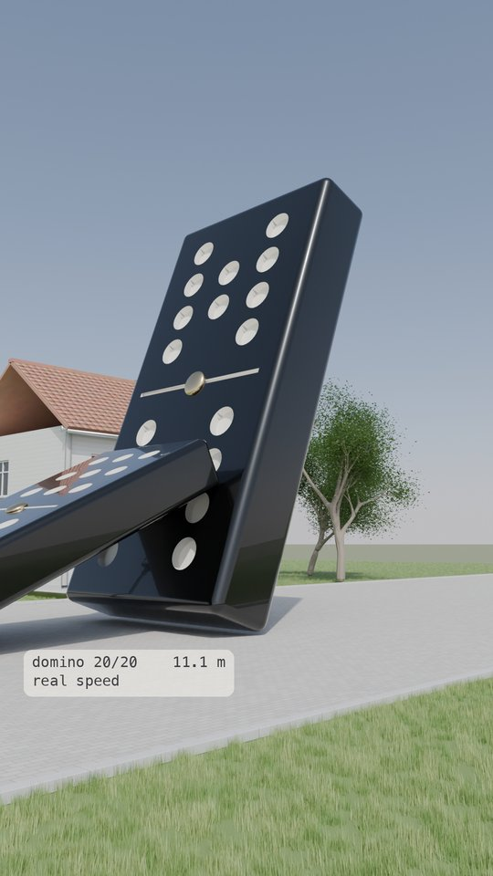
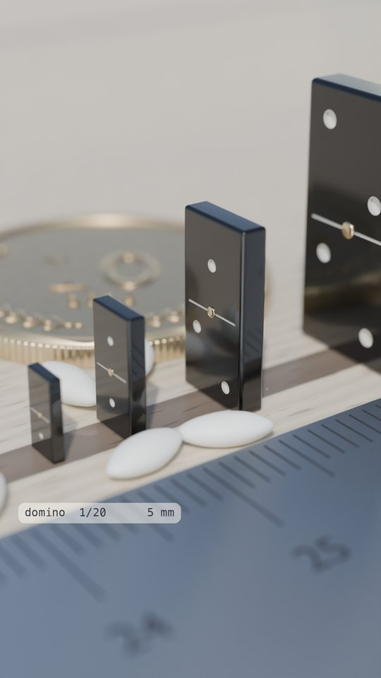
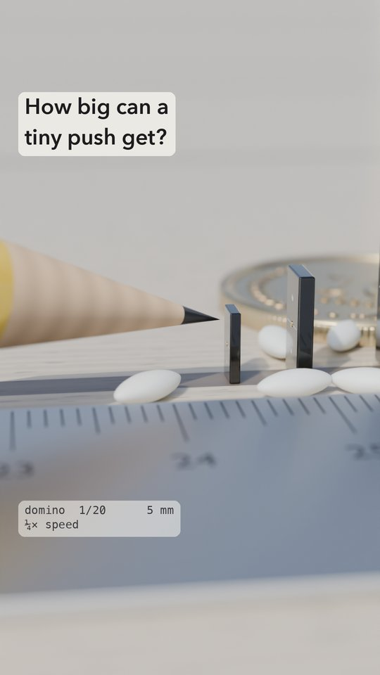
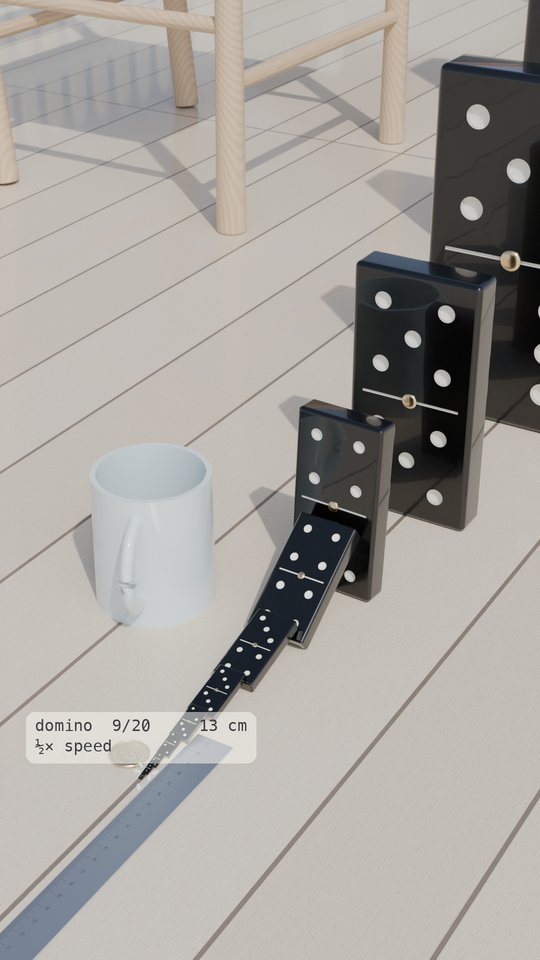
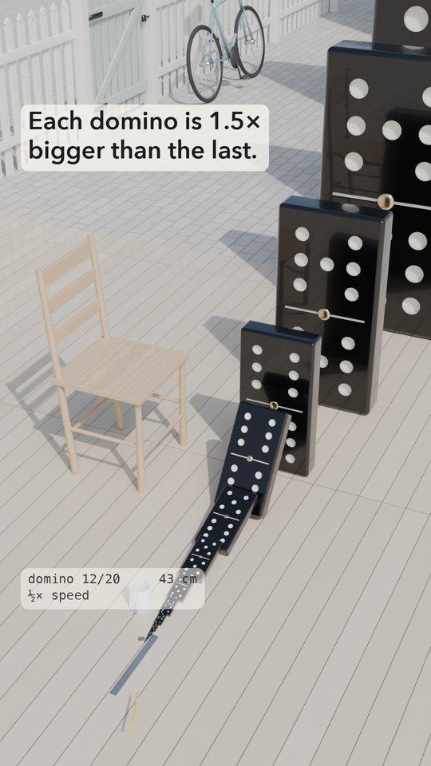
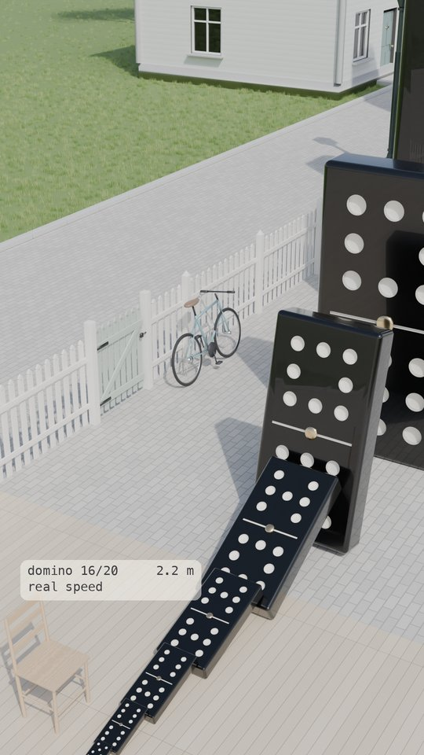
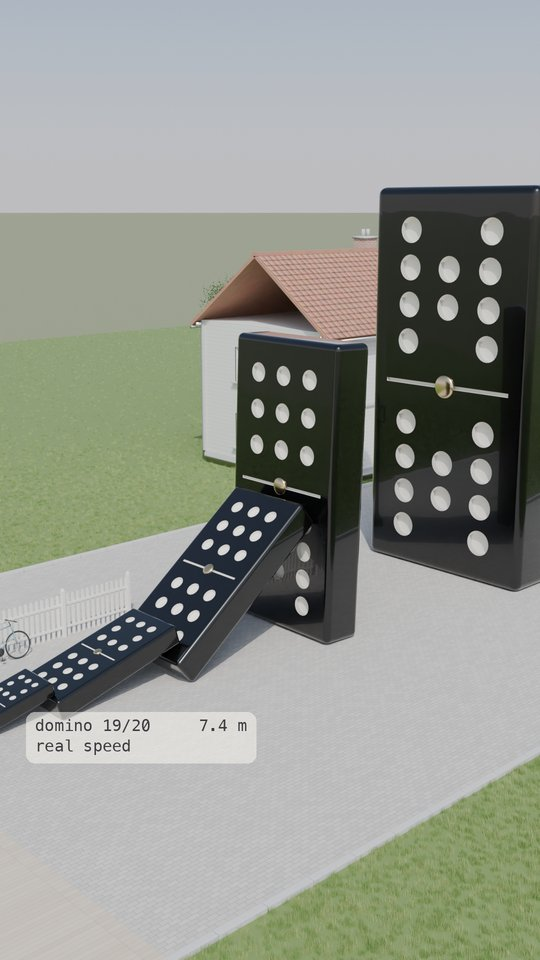
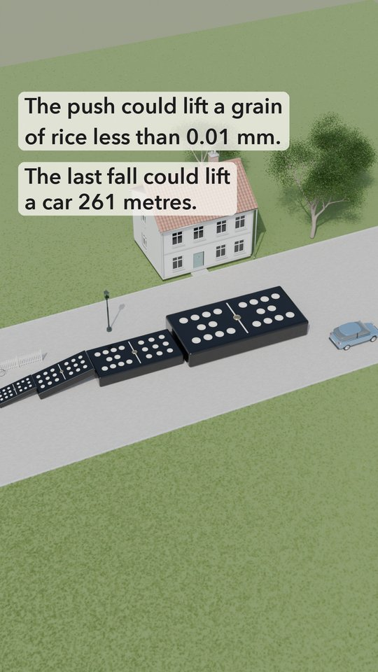

# The smallest push



A pencil nudges a domino 5 mm tall. Each domino is 1.5 times bigger than the one before it, and the twentieth is
11 metres tall and weighs 66 tonnes. **One physics simulation runs the whole chain at true size**, from the pencil's
1.745 nanojoules to the giant's 3.07 megajoules, and every number on screen is measured from that run.

**Watch:** [on Instagram](https://www.instagram.com/p/DfeokiXxeO9/), [on YouTube](https://youtube.com/shorts/KUg2iY-p1Ss), or download it from the [`dominoes-v1` release](https://github.com/beingcognitive/unreelcode/releases/tag/dominoes-v1):
38 s, 1080x1920 (9:16), 30 fps, with sound. It loops: the end card dissolves into the first frame.

<br clear="right">

| | | | |
|---|---|---|---|
|  |  |  |  |
| 0:01 the first dominoes | 0:04 the pencil | 0:09 mug size | 0:12 chair size |
|  |  |  |  |
| 0:18 fence and bicycle | 0:22 eye level | 0:27 the giant falls | 0:33 the two numbers |

## The film
| Time | What happens |
|---|---|
| 0–3.5 | The first dominoes stand still. A pencil comes in, and "How big can a tiny push get?" |
| 3.5 | The push. The simulation starts, at ¼ speed |
| 7–11 | "Each domino is 1.5× bigger than the last." Half speed from 7.5 s |
| 3.5–25 | The camera follows the front past things for scale: rice and a ruler, a coin, a mug, a chair, a fence and a bicycle, a lamp post, a house. Real speed from 17.5 s |
| 25–28.5 | The giant falls at real speed, seen from eye level, and lands with two small bounces |
| 29–35 | "20 dominoes." "The push could lift a grain of rice less than 0.01 mm." "The last fall could lift a car 261 metres." |
| 35–38 | The end card, dissolving back into the first frame |

A readout in the corner always shows the domino number, its height and the playback speed. Each domino's pips show its
number (domino 7 is 3 | 4, as in a double-twelve set).

## How it's made
**The physics** ([`sim.py`](sim.py), [`film_sim.py`](film_sim.py)), in MuJoCo 3.17.0:
- **20 rigid wooden boxes at true size,** 5 mm to 11.08 m tall (thickness 0.15 h, width 0.5 h, 650 kg/m³), each set
  0.75 of its own height in front of the next. Real gravity; Coulomb friction, μ 0.8 on the floor and 0.3 between
  dominoes. Nothing is scripted once the pencil touches domino 1.
- **The push is measured, not assumed.** The pencil's tip is a 0.25 mm sphere moving at 3 mm/s. The work it does on
  domino 1 is 1.745 nJ (the tipping barrier is 1.672 nJ); the giant releases 3.068 MJ as it falls flat. That is
  1.76 × 10¹⁵ times more. With a 20 mg grain of rice the push lifts it 8.9 µm; with a 1,200 kg car the last fall lifts
  it 260.6 m.
- **The 1.5× ratio is the limit we measured.** In a scan of 12-domino chains (4 trials with jittered gaps and two
  floor frictions), 1.5 was the largest ratio that always toppled at this spacing (`python sim.py scan`). It matches
  the classic demonstrations (Whitehead, *Am. J. Phys.* 51, 182, 1983; the University of Toronto demo). An idealised,
  frictionless theory allows about 2 (van Leeuwen, arXiv:1301.0615).
- **Each cycle is about √1.5 = 1.22 times slower than the last,** as theory predicts; the chain measures 1.22–1.28.
  The giant takes 3.62 s to fall.

**The bounce** ([`render/restitution.py`](render/restitution.py), [`render/speed_zeta.py`](render/speed_zeta.py)):
how much a block bounces (its coefficient of restitution, e) is set from measurements and falls with impact speed:
- **anchors:** wood on wood e = 0.45 at about 1.33 m/s (Alonso-Marroquín et al., *Granular Matter* 15, 2013,
  arXiv:1405.3049), and stone on concrete e = 0.35 at about 6.49 m/s (Wang et al., *NHESS Discussions*, 2018);
- **the law:** above the anchor speed, e falls as v^(−1/4) (Thornton, *J. Appl. Mech.* 64, 383, 1997);
- **in the chain:** domino on domino e runs from 0.45 down to 0.32, the giant's landing 0.28 (at 16.3 m/s). The giant's
  far end lifts 0.87 m off the floor, and it bounces twice;
- **in MuJoCo,** a contact's bounce is set by its damping ratio. `restitution.py` measures e against the damping ratio
  in drop tests (the same curve at 5 mm, 0.5 m and 10 m), and each contact pair gets the damping ratio for its own e.

**The picture** ([`render/`](render/)): Blender 5.1 Cycles, 64 samples per pixel, denoised. Everything is built in
Python: geometry, materials, the sky. No downloaded models, image textures or HDRIs. Every domino's position and
rotation in every frame comes from the simulation, recorded at 1 kHz. The props stand at true size and never touch
the chain: they are placed clear of every domino's fall and rest.

**The sound** ([`sound.py`](sound.py), [`master.py`](master.py)), synthesised from the simulation:
- **a click for every impact,** at the simulated time, its loudness from the impact energy and its pitch from the
  domino's size;
- **a soft bell as each domino starts to move,** one step down an A-minor scale per domino, so all 20 have their own
  pitch, from F5 for the smallest to A2 for the giant;
- **the landing** is a low A-minor chord with a soft thud;
- mastered to −14 LUFS.

**Display only:** the 3.5 s opening before the push (the chain stands still, and the pencil's glide into place is
animated to arrive exactly where and as fast as the simulated pencil starts); the playback speed (¼×, ½×, then real
speed, always labelled); the camera; the depth of field in the opening; all text.

**Simplifications:**
- **The contacts are soft, scaled to each pair's size.** MuJoCo's contacts are slightly springy, with a stiffness set
  in absolute units, so one value can't suit both 5 mm and 11 m. Each pair gets a time constant of 0.0025·√(h/g) and a
  width of 0.000125·h, so every contact is equally hard relative to its own dominoes. Halving the time constant again
  changes the cycle time by under 1 %. Deepest overlap: 0.24 % of a domino's thickness between dominoes, 0.70 % when
  the giant lands. Timestep 7.1 µs.
- **The bounce law is derived for spheres** and applied here to the edges and faces of blocks. **The floor anchor is
  stone on concrete,** not wood.
- **The dominoes are perfectly rigid.** A real 11 m, 66 t wooden slab would very likely crack when it lands.
- **No air.**
- **The pencil is kinematic:** it moves on its path whatever the forces, like a motorised stage.
- **Pips are on one face only.**

## Build
Python 3.11 on macOS (Apple Silicon), ffmpeg on PATH, and [Blender 5.1](https://www.blender.org/download/) (set
`BLENDER` if it isn't at `/Applications/Blender.app`). Uses the Avenir Next and Menlo system fonts. Run from this folder.
```
python -m venv ../.venv && ../.venv/bin/pip install -r ../requirements.txt -r requirements.txt
PY=../.venv/bin/python
$PY render/restitution.py                                   # out/restitution_scan.json: bounce vs damping ratio
ZETA_DD=0.264 ZETA_FL=0.375 OUT=out/chain_constant_e $PY film_sim.py   # a run with constant bounce (~15 min)
$PY render/speed_zeta.py out/chain_constant_e 20 out/zeta_speed.json   # its impact speeds -> each pair's bounce
ZETA_FILE=out/zeta_speed.json $PY film_sim.py               # out/film_chain.*: the film's chain (~15 min)
$PY render/timeline.py json                                 # out/timeline.json: camera and sim time per frame
render/render_chunked.sh "$(seq -s, 0 1051 | sed 's/,$//')" out/raw 1.0 64   # 1,052 frames, ~10 s each
$PY sound.py && $PY master.py                               # out/audio/audio.wav
FRAMES_DIR=out/frames $PY render/compose.py out/raw out/film.mp4
$PY render/check_numbers.py                                 # every number on screen, recomputed
```
The renderer starts a fresh Blender session every 40 frames: one long session once turned the house's roof black.
`render/qa.py out/raw 1052` scans the frames for flicker, sudden dark patches, fireflies and gaps.
`render/bounce_metrics.py out/film_chain` measures each landing's bounces.

## Measured
- **Reproducible:** run again from this folder, the simulation (all 2.77 million contact events and every pose), the
  timeline and the audio are identical bit for bit to the film's, and composing the film's frames gives a
  byte-identical MP4. Three re-rendered frames match the film's to within 2/255 per pixel (GPU rounding).
- **Numbers on screen:** all checked against the simulation by `check_numbers.py`.
- **Frames:** 0 glitches in 1,052 rendered frames (`qa.py`).
- **Loudness:** integrated −13.9 LUFS, true peak −1.3 dBTP, **after AAC encoding** (ffmpeg ebur128 on the final file).

## Known flaws
- **1.5× has no margin.** It is exactly the largest ratio that toppled reliably in our scan; 1.55 fails at the first
  link.
- **The sound is chosen, not simulated.** The clicks' pitches are scaled down for the big dominoes (a real 11 m block
  would ring below hearing), and the bells and chord are music.
- **One stray contact is silenced:** the 5 mm domino 1, lying flat, gets a tiny numerical jolt 12 s into the
  simulation. Contacts more than 20·√(h/g) after a domino starts moving are not sounded.
- **The giant's two bounces are silent.** The simulation's contact log has no fresh hard contact for them (the slab
  never fully leaves the floor), so the code written to give them soft taps finds nothing to play.
- **The sound has been checked by the director's ear and by measurement,** but never by Claude's.

## Versions
- **v1:** a fast GPU ray tracer. Contacts were too soft: domino 19 sank 5.7 % into domino 20, and the chain ran about
  25 % too fast.
- **v2:** stiff contacts (converged), the same simple look. The director asked for real detail, so that it wouldn't
  look "too simulational".
- **v3** (8 Nov, this cut): rebuilt in Blender with real detail (pips, a pencil, rice, a ruler, a coin); the measured
  bounce, compared side by side with a constant one that felt too bouncy; a fence and bicycle in place of a shed that
  read as a second house; the director's notes on the opening, the camera, the captions and the sound.

---
Made by Claude Code, Opus 5.5 · directed by being.cognitive. Part of [unreel()](../): films written in code, not filmed.
