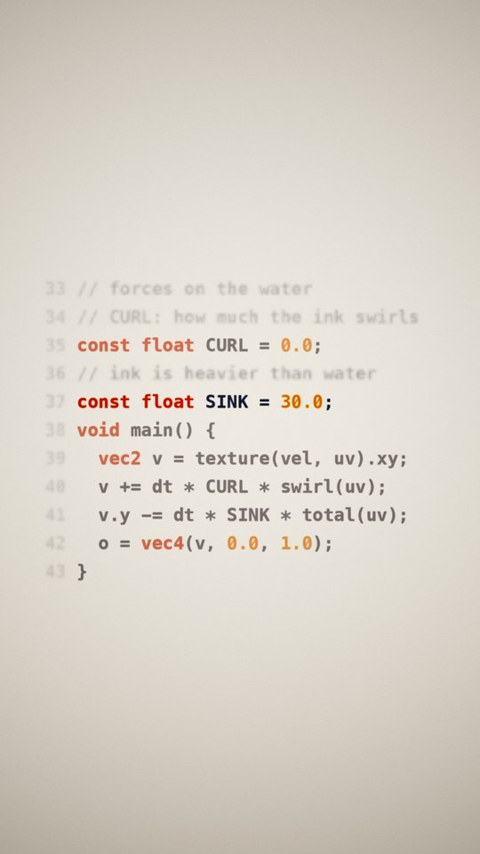
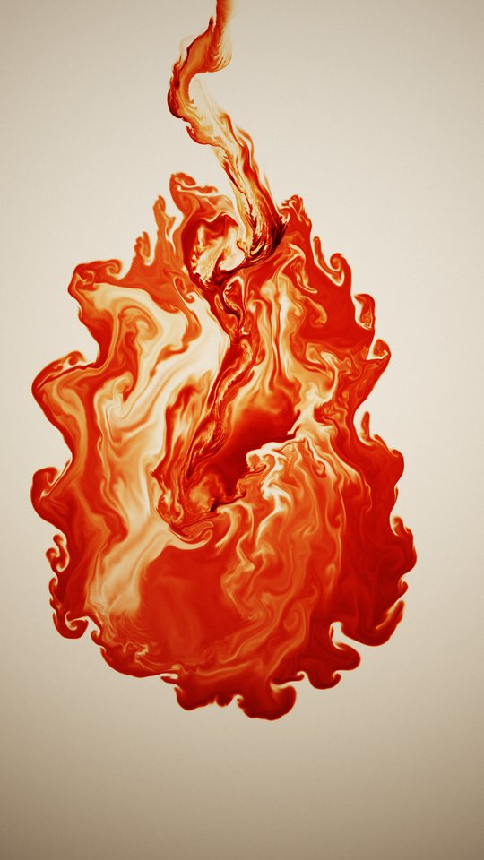
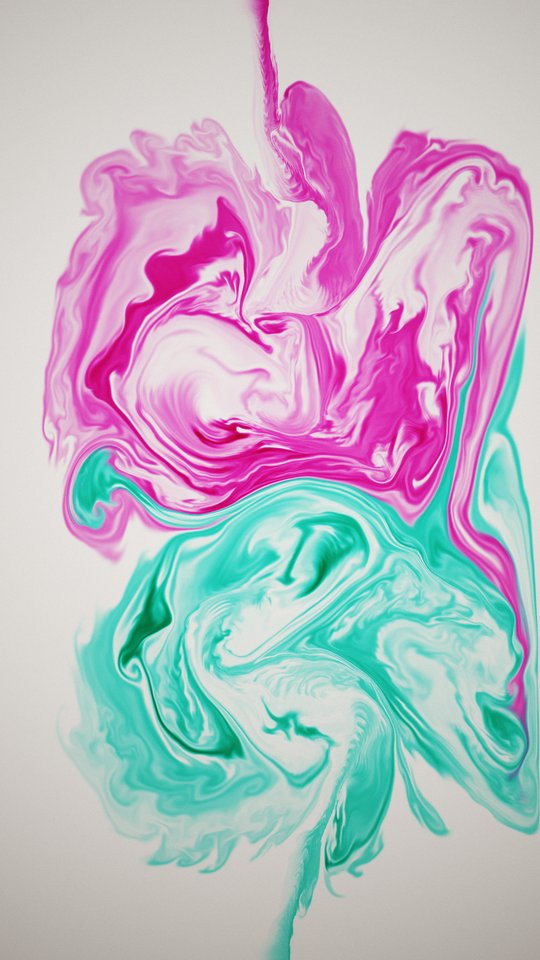
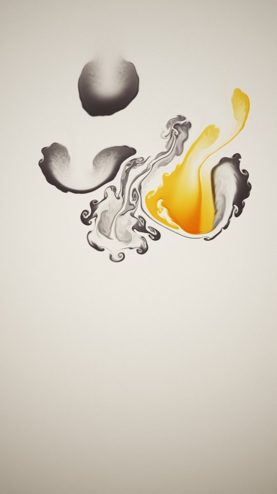
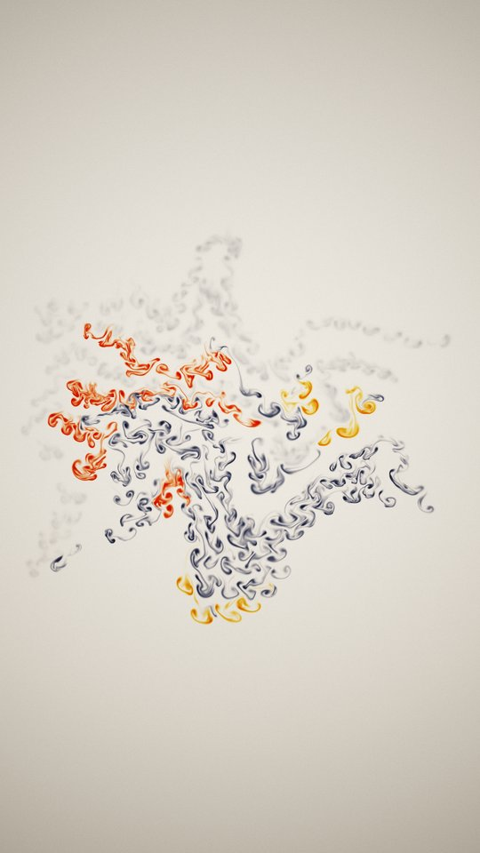
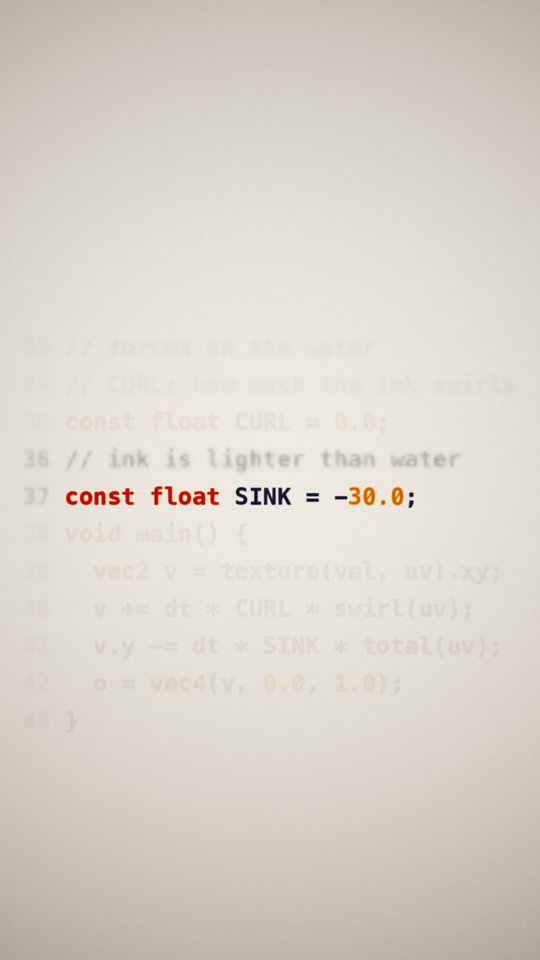
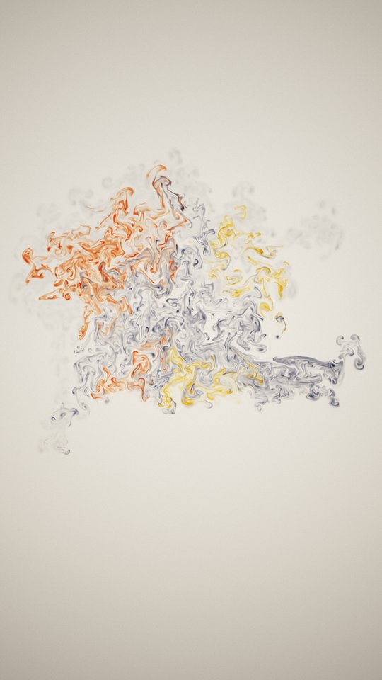
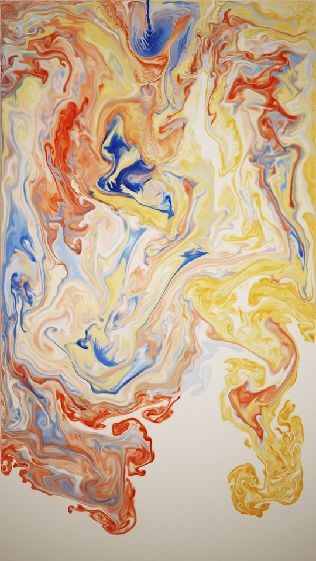

# Ink: code that writes itself



Ink in water: a plume, falling fingers, two jets colliding, drops on the beat. Then a cloud of every colour gathers
into the lines of the shader that is simulating it. One value is retyped (`SINK = 30.0` becomes `SINK = -30.0`), the
solver is recompiled from exactly that text, and the same letters come apart **upward**, because the ink is now
lighter than water.

**Watch:** [`ink-v1` release](https://github.com/beingcognitive/unreelcode/releases/tag/ink-v1): 52.5 s, 1080x1920
(9:16), 24 fps, with sound. It loops: the last half second dissolves into the first frame.

Every drop, plume and swirl comes from one GPU fragment shader, [`shaders/ink.glsl`](shaders/ink.glsl): **107
non-blank lines of GLSL**. That count is read from the file when the film is assembled and printed on the end card.

<br clear="right">

| | | | |
|---|---|---|---|
|  |  |  |  |
| 0:01 plume | 0:06 falling fingers | 0:09 clash | 0:13 drops on the beat |
|  |  |  |  |
| 0:20 the code forms (in reverse) | 0:26 one sign flipped | 0:33 the letters rise | 0:44 final bloom |

## The film, bar by bar
96 BPM in 4/4, so one bar is 2.5 s. Every cut is on a bar line.

| Time | Bars | Picture | On screen | Music |
|---|---|---|---|---|
| 0–5 | 1–2 | **Plume.** A crimson and orange pipette jet, already blooming on frame 1 (1.8 s pre-roll), backlit | "Watch this ink. / It's about to write something." then "simulated, not filmed" | Sub boom on frame 1, D drone, Dm9 pad, the motif D‑F‑A‑G‑F‑E on an FM bell |
| 5–7.5 | 3 | **Rayleigh–Taylor.** A layer of Prussian and cerulean ink fingers down into mushrooms, in cool light | | Bbmaj7. A pluck pulse driven by the flow's energy starts |
| 7.5–10 | 4 | **Clash.** A magenta jet from the top and a teal jet from the bottom meet and roll up | | F, full motif |
| 10–15 | 5–6 | **Drops.** A sumi-black or gold drop is released on every beat, at varied depths, and each makes a vortex ring | | C to Gm7. A soft tom on every drop, the motif in eighths |
| 15–22.5 | 7–9 | **The turn.** A cloud of all the inks converges into code. This is the dissolve **played backwards** | (no text) | Gm/A, Bb/A, Asus over an A pedal. Time-reversed pad swells, reversed bells, a 7.5 s riser |
| 22.5–27.5 | 10–11 | **The edit.** The tank is paused. The camera pushes in on lines 36–37 and everything else fades back. `30.0` is retyped to `-30.0` one key per 16th note, then the comment `heavier` to `lighter` one key per 32nd note. The shader is recompiled and the camera pulls back | "This is the code / that moves the ink." then "Now flip one sign." | Dm9, the quietest point: the motif alone. Then a tick on every keystroke, and the motif returns with **one note changed** (F‑E becomes B♭‑A), mirroring the one-line edit |
| 27.5–37.5 | 12–15 | **Release.** A real forward run with `SINK = -30.0`: the same letters rise, curl and pile under the surface | "now ink is lighter than water" | An impact on the downbeat, kick, eighth-note bass, shaker, the edited motif in octaves. The loudest section |
| 37.5–47.5 | 16–19 | **Bloom.** Crimson, cerulean and gold pour in together and fill the frame | | Bbmaj7, F, Gm7, Asus. The pulse thins out |
| 47.5–52.5 | 20–21 | **End card** over the darkened bloom | "107 lines of GLSL / move all of the ink in this video. / (the code-forming shot runs in reverse)" and `github.com/beingcognitive/unreelcode` | Dm9, the motif's first three notes rising to a high D |

**The code on screen** is lines 33–43 of `shaders/ink.glsl`, as compiled for that shot:
```glsl
// forces on the water
// CURL: how much the ink swirls
const float CURL = 0.0;
// ink is heavier than water        <- retyped: lighter
const float SINK = 30.0;            <- retyped: -30.0
void main() {
  vec2 v = texture(vel, uv).xy;
  v += dt * CURL * swirl(uv);
  v.y -= dt * SINK * total(uv);
  o = vec4(v, 0.0, 1.0);
}
```

**Sonification.** The mean kinetic energy of the velocity field on screen (from each shot's `stats.json`, reversed for
the backwards shot, log-scaled, smoothed over half a second) sets only the **probability** of each 16th-note pluck,
its loudness and its brightness, plus the shaker density in the release. Pitch always comes from the bar's chord.

## What is simulated, what is guided, what is stylised
**Simulated** (`shaders/ink.glsl`, run by `ink.py` through moderngl, OpenGL 4.1): incompressible 2D stable fluids in a
tall, closed tank.
- Velocity grid 540×960. Ink grid 1080×1920 with 4 pigment layers, shown 1:1.
- MacCormack advection with an RK2 backtrace and clamping, for both velocity and ink.
- Vorticity confinement (`CURL`) and buoyancy (`SINK`, positive when ink is heavier than water).
- 60 Jacobi pressure iterations per step, dt = 1/48 s (2 steps per frame).
- Ink has no explicit diffusion. It only spreads through numerical diffusion.

**Driven:** nozzles, i.e. gaussian "splats" of momentum and ink at fixed places, like a pipette, in the plume, clash,
drops and bloom. The Rayleigh–Taylor shot starts from a perturbed ink layer. The water's initial motion is smoothed
random noise.

**Every shot runs the same shader.** `shots.py` rewrites only the two `const` lines through the same `patch()`:

| Shot | CURL | SINK |
|---|---|---|
| plume | 1.5 | 40.0 |
| Rayleigh–Taylor | 0.8 | 45.0 |
| clash | 1.0 | 8.0 |
| drops | 1.0 | 35.0 |
| code (formation, hold) | 0.0 | 30.0 |
| release | 0.0 | **−30.0** |
| bloom | 1.0 | 30.0 |

**How the code text is made:**
- The letters are typeset with Menlo Bold into the ink field as the **initial condition**. One pigment per syntax
  class: keywords crimson, numbers gold, code indigo-black, comments and line numbers grey.
- The excerpt is read from the exact source string the solver was compiled from. After the edit, an assertion checks
  that every line on screen appears in the recompiled source.
- **The formation is a forward simulation of the text dissolving, played backwards.** No force pulls ink toward the
  glyphs.
- **The hold is a held frame:** the simulation is paused. The push-in and the fading of the other lines are display
  only.
- **The edit is guided:** each keystroke re-typesets the ink in the paused tank. It is not fluid motion. After the last
  key, the shader is recompiled from the edited text, and the release is a real forward run with `SINK = -30.0`.

**Stylised display** (`shaders/look.glsl`), which never moves ink:
- Beer–Lambert absorption of a warm backlight per pigment, plus a small scatter term.
- Bump shading from blurred density, a self-shadow march, and refraction of the background by the density gradient.
- Depth of field per layer via mip levels, ACES tone mapping, vignette, and per-pixel hashed film grain with TPDF dither.
- Captions and the end card are typeset with PIL and composited (`assemble.py`).

## Build
Python 3.11 on macOS (Apple Silicon), with ffmpeg on PATH. Uses the Menlo system font.
```
python -m venv ../.venv && ../.venv/bin/pip install -r ../requirements.txt
for s in hook rt clash drops codeA codeB bloom; do ../.venv/bin/python render.py $s; done   # cache/<shot>/####.png + stats.json
../.venv/bin/python music.py        # cache/music.wav (reads each shot's stats.json)
../.venv/bin/python assemble.py     # out/film.mp4
```
Each shot is cached as PNG frames, so the build is resumable and any shot can be re-rendered alone.
`preview.py` renders quick single frames of a shot.

## Measured
- **Loudness:** integrated −14.0 LUFS, peak −2.2 dBFS **after AAC encoding** (ffmpeg ebur128 on the final file).
- **Compute:** 3,002 solver steps, including pre-rolls, for 1,440 rendered frames, of which the cut uses 1,260.
  Simulating and shading all seven shots took 303 s (about 5 minutes) on an M3 Pro, including writing the PNG frames.
- **Code:** 1,217 non-blank lines in total: the solver (`ink.py`, `ink.glsl`), the look shader, shots, text,
  render, music and assembly.
- **No blank frames:** every one of the 1,260 frames has visible ink.

## Known flaws
- **It is 2D.** Ink sheets don't thin by stretching as they would in 3D, so large regions stay evenly dense. It reads
  more like marbled paper than smoke, especially in the clash and the end of the bloom.
- **The formation reads as squiggles until late.** Thin strokes go unstable at once in the forward run, so played
  backwards the glyphs grow out of tiny bead-like droplets. The text is readable only in the last second before the
  hold.
- **The release rises slowly** in the tall tank. The first second after the flip shows little movement.
- **Ink piles against the lid and floor** of the closed tank late in the release and the bloom.
- **The music has been checked only by measurement** (loudness, peaks, per-bar level), never by ear.

## Versions
- **v1** (1 Nov): 60 s landscape 2.39:1. An independent Reels/Shorts review scored it 5/10: a five-second stretch of
  empty frames (a bug left the drops shot empty), a late premise, and code too small to read on a phone.
- **v2** (2 Nov): native vertical tank. The drops bug fixed (the beat test never fired once the pre-roll put the
  clock off the beat grid). The shader excerpt reformatted to read at 39 px. The comment is retyped too, so it stays
  true. Captions added.
- **v3** (3 Nov, this cut): the cold open, which showed the rising code before the story began, is removed. The
  formation is longer (7.5 s instead of 5 s) and has no text over it. The reveal is named only once the code is
  readable. The repo URL is added to the end card.

---
Made by Claude Code · directed by nolimit. Part of [unreel()](../): films written in code, not filmed.
