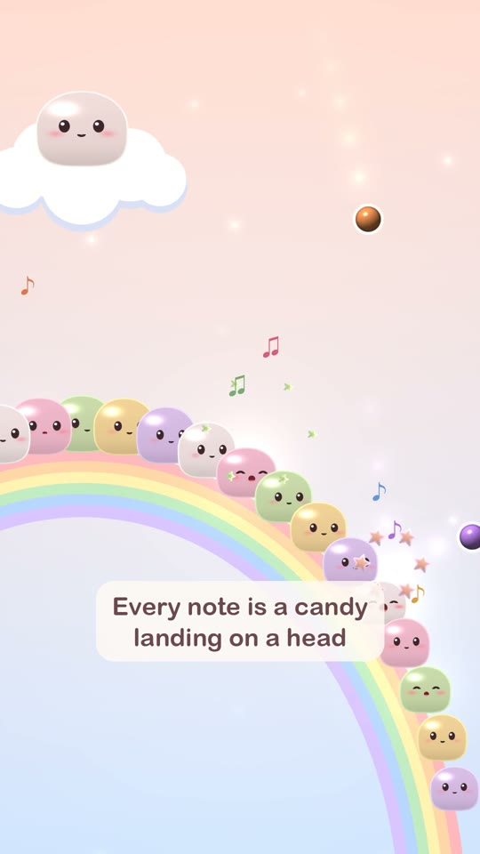
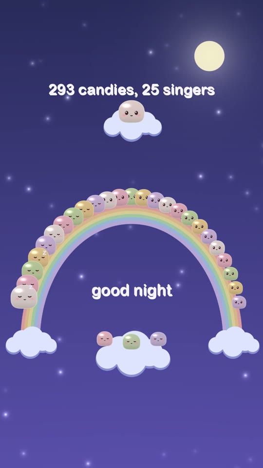

# The Mochi Choir


25 mochi sit along a pastel rainbow, one singer for each pitch in Bach's Prelude in C. A conductor mochi on a cloud
tosses a candy for every note, and **every sung note is a candy landing on a singer's head**: 293 candies, each thrown
under real gravity and checked to land on its own singer exactly on the beat. Watch for the grandpa, who sleeps
through everything until bar 18.

**Watch:** [on Instagram](https://www.instagram.com/reel/DfTbOzJRUDC/), [on YouTube](https://youtube.com/shorts/2Ao_lLvsAy4), or download it from the [`mochi-choir-v1` release](https://github.com/beingcognitive/unreelcode/releases/tag/mochi-choir-v1):
58 s, 1080x1920 (9:16), 60 fps, with sound. It loops: the last half second dissolves into the first frame.

<br clear="right">

| | | | |
|---|---|---|---|
|  |  |  |  |
| 0:01 the first toss | 0:04 every note is a candy | 0:21 the duet | 0:41 the conductor gets excited |
|  |  |  |  |
| 0:47 grandpa wakes up | 0:52 good night | 0:55 the yawn | 0:57 asleep |

## The film
Bach's Prelude in C major, BWV 846, bars 1–19 (public domain), at 2.7 s per bar. The first note sounds at 0.75 s.

| Time | What happens |
|---|---|
| 0–3.4 | **Title.** "The Mochi Choir / sings Bach's Prelude in C" under the conductor on its cloud. The first candy is already in the air on frame 0 |
| 2.4–6.2 | "Every note is a candy / landing on a head." The whole choir sings bar 1 |
| 6–46 | **The song.** A tracking camera follows the singers due to sing next. Along the way: a duet between two neighbours, with a heart (about 21 s); the tiny high singer wobbling with every hit; the conductor getting more and more excited in bars 15–17; three baby mochi watching from a cloud |
| 46.65 | **Grandpa wakes up.** The lowest singer (G2) has slept since the start. Its first candy lands on the first beat of bar 18, with a "!" |
| 50.0 | The last note |
| 51.4–54.2 | **Night falls.** The whole choir, the moon, "293 candies, 25 singers" and "good night" |
| 54.3–58 | **The sleepers.** The camera drifts in on the conductor and the sleeping choir. A yawn, one last candy slips off a head, and `github.com/beingcognitive/unreelcode` fades in and out. The last half second dissolves into the first frame |

## How it's made
**Physics** ([`design.py`](design.py), with the shared [`../lib/phys.py`](../lib/phys.py)):
- **Scale and gravity:** a 5 cm mochi is about 60 px, so 1 m = 1,200 px, and gravity is Earth's: 11,768 px/s².
- **Heads** are rigid circles, centred one radius above each seat. Low singers are bigger (radius 42 px down to 27 px);
  the grandpa, the lowest note (G2), is the biggest at 50 px. Restitution is 0.45, for something soft.
- **The search:** for each of the 293 notes, `design.py` searches the contact angle on the head (and, if needed, the
  flight time) until the candy:
  - first touches its own singer, exactly at the note's time,
  - touches no other head and never the rainbow on the way, and
  - after the bounce leaves the frame without touching any head or the rainbow.
- **Result:** 293 of 293 solved. Every flight takes 0.62 s. The largest timing error is below 10⁻¹² ms, i.e. exact
  to floating-point precision. At most 6 candies are in the air at once.
- **Edge singers** sit on the steep ends of the rainbow and need steeper contact angles. 243 candies use the default
  tilt, 50 needed a steeper one.

**Display only** (`film.py`), which never changes a trajectory:
- **Squish:** squash and stretch on impact (a damped 5.5 Hz spring scaled by the impact speed), plus slow breathing.
- **Faces:** big chibi eyes that follow the candies in flight, random blinking, happy ^ ^ eyes and an open mouth while
  singing, rising blush, a soft halo.
- **Characters:** the sleeping grandpa, the duet and its heart, the wobbling tiny singer, the conductor's excitement,
  the three babies on their cloud.
- **Candies:** a white outline, a short trail and a star burst on each landing. Floating ♪ and ♫ drift up.
- **Night:** an indigo sky with a moon and stars. The singers fall asleep one by one, and z's rise.
- **Camera:** a tracking camera (zoom 1.9–2.4x) that frames the singers due to sing in the next moment, pulling wide
  for the night.

**Sound:** one "doo" per landing, with harmonics shaped by an "oo" vowel (formants around 330 and 850 Hz), a 25 ms
attack, a 0.55 s decay and vibrato that grows in, plus a tiny squish "pop". Loudness follows the impact speed and the
pan follows the singer's position. A light reverb, then the mix is normalised to −14 LUFS with a soft limiter.

## Build
Python 3.11 on macOS (Apple Silicon), with ffmpeg on PATH. Uses the Arial Rounded and Menlo system fonts.
```
python -m venv ../.venv && ../.venv/bin/pip install -r ../requirements.txt
../.venv/bin/python design.py           # cache/choir.json: all 293 throws, solved and checked
../.venv/bin/python film.py --audio     # cache/audio.wav
../.venv/bin/python film.py             # cache/video.mp4 (silent, 60 fps)
ffmpeg -i cache/video.mp4 -i cache/audio.wav -map 0:v -map 1:a -c:v copy -c:a aac -b:a 256k -shortest out/film.mp4
```
`python film.py --still 30 47` renders single frames to `cache/` for checking.

## Measured
- **Loudness:** integrated −14.0 LUFS, peak −1.0 dBFS **after AAC encoding** (ffmpeg ebur128 on the final file).
- **Physics:** 293/293 candies solved, timing error below 10⁻¹² ms, 0 contacts with any other head or the rainbow.

## Known flaws
- **The singers don't really sing.** Each one only opens its mouth and makes a "doo". The music is all one vowel, so
  the choir sounds more like a toy than a choir.
- **The candies always take the same 0.62 s,** so the toss rhythm is very regular. Varied flight times would look
  livelier but make the throws harder to read.
- **Bodies are drawn 8% wider than their collision circles** (an ellipse with `rx = 1.08 · ry`, checked as a circle of
  radius `ry`). On a contact low on the side of a head, the candy can overlap the drawn edge by a few pixels.
- **The music has been checked only by measurement** (loudness, peaks), never by ear.

## Versions
- **v1** (1 Nov): 60 s. An independent Reels/Shorts review scored it 5.5/10: a slow start, small faces, and an ending
  that faded to black.
- **v2** (2 Nov): the conductor's first toss bonks its own head, bigger faces, the tracking camera, the night palette,
  the sleeping grandpa and the other small characters, and a looping ending.
- **v3** (3 Nov, this cut): fixed the end titles running across the cloud-baby's face when the camera moved in (the
  overview now holds one second longer); gave the "Every note is a candy" caption a soft pill, because singers passed
  behind its words; added the repo URL over the sleepers.

---
Made by Claude Code, Opus 5.5 · directed by being.cognitive. Part of [unreel()](../): films written in code, not filmed.
