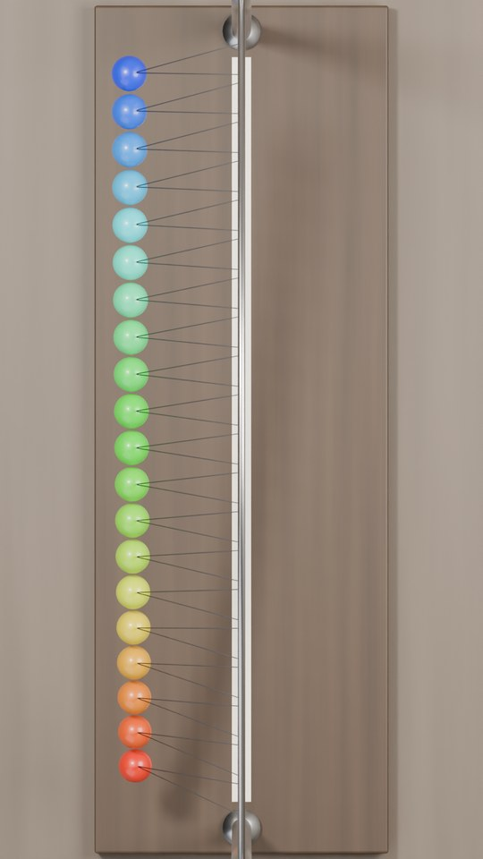
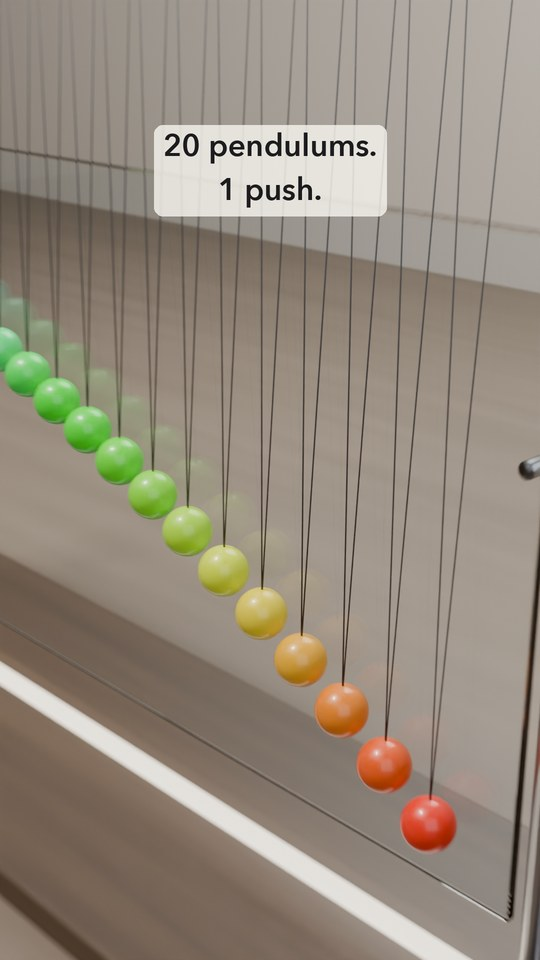
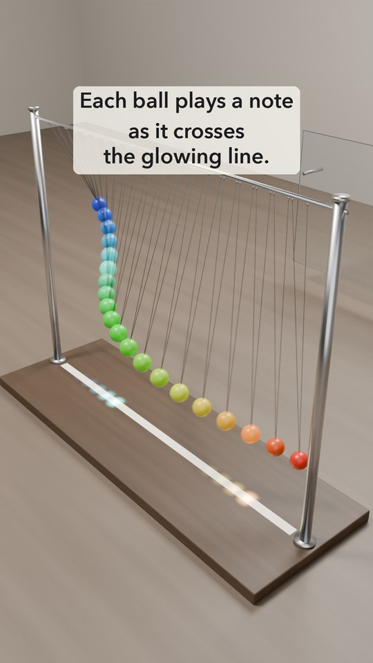
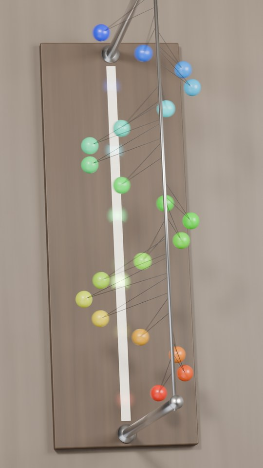
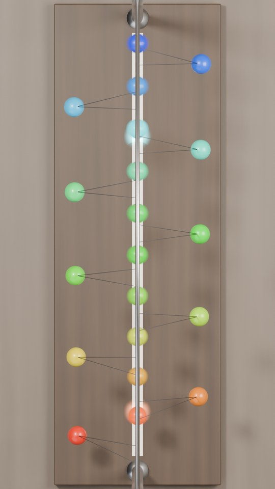
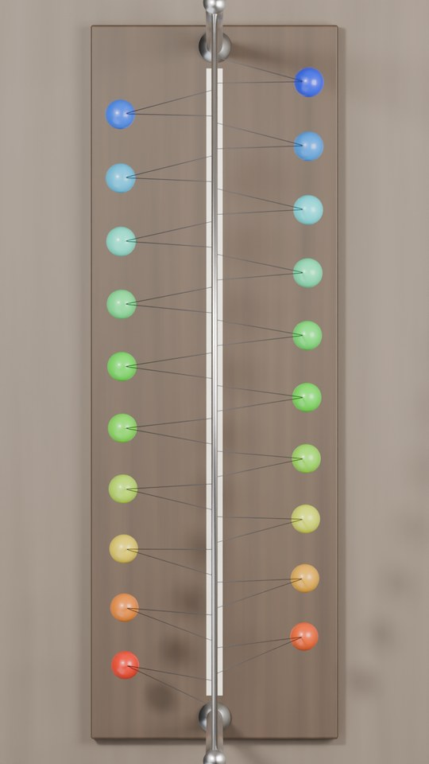
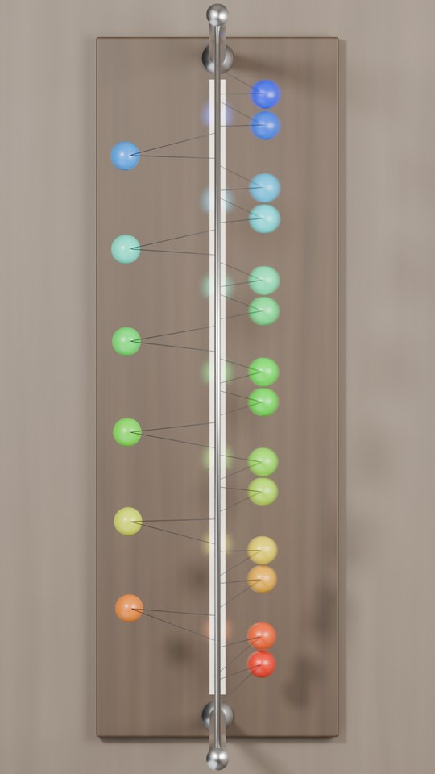
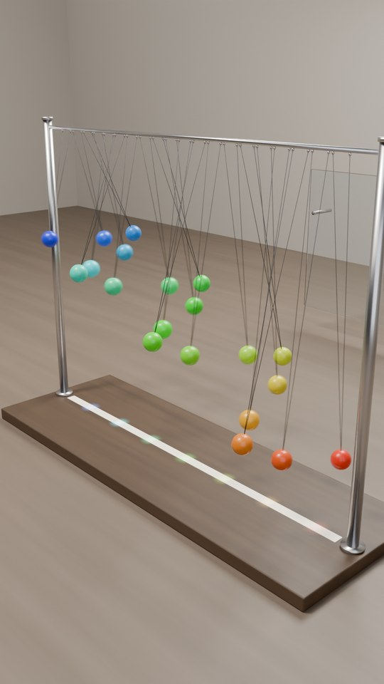

# 20 pendulums, 1 push



A flat board pushes 20 pendulums out together, so that seen from above every ball starts on one straight row. Each
pendulum is a little shorter than the last: in 60 seconds the longest swings 40 times and the shortest 59. Left
alone, they run through a travelling wave, four, three and two rows, a tangle, and the rows in reverse. **At exactly
60 seconds every ball is back on the same straight row,** to within 10⁻¹¹ mm in the simulation. Each ball plays its
note as it crosses a glowing line on the floor.

**Watch:** [on Instagram](https://www.instagram.com/p/DgNM0kDxkKb/), [on YouTube](https://youtube.com/shorts/E4ifQ94O8Ik), or download it from the [`pendulum-wave-v1` release](https://github.com/beingcognitive/unreelcode/releases/tag/pendulum-wave-v1):
67 s, 1080x1920 (9:16), 30 fps, with sound. It loops: the end card dissolves into the first frame.

<br clear="right">

| | | | |
|---|---|---|---|
|  |  |  |  |
| 0:01 the push | 0:04 the first crossings | 0:10 up to the top view | 0:17 four rows (15 s) |
|  |  |  |  |
| 0:32 halfway: two rows | 0:42 three rows (40 s) | 0:52 the tangle | 1:02 one line (60 s) |

## The film
Film time is the simulated time plus 2 s.

| Time | What happens |
|---|---|
| 0–2 | "20 pendulums. 1 push." A clear board slides in and pushes every ball out to 120 mm from the centre line |
| 2 | The release. The board pulls back faster than any ball can follow |
| 2–7 | Seen in 3/4, the first crossings of the glowing line: each one is a note and a spot of light. "Each ball plays a note as it crosses the glowing line." |
| 7–11.6 | The camera cranes up to look straight down |
| 11.6–48.4 | Straight down, one very slow zoom-out: four rows (0:17), three (0:22), two at halfway (0:32), then three (0:42) and four (0:47) again |
| 48.4–54.6 | Down to a low 3/4 view of the tangle |
| 54.6–62 | Back up. The camera settles straight down at exactly 60.00 s of simulated time: all 20 on one straight row, a sweep of notes along the line either side of it, and a soft chord |
| 62–64.4 | A beat on the line, then home to the opening view |
| 64.4–67.2 | The end card, dissolving back into the first frame |

There is no text after 7 s: the payoff is left to the picture and the sound.

## How it's made
**The physics** ([`sim.py`](sim.py)):
- **A flat-board release, like a real demo.** The board puts every ball centre at the same offset, X0 = 120 mm, so each
  pendulum has its own amplitude, asin(X0/L): 12.47° on the longest up to 28.90° on the shortest.
- **Each length is solved for its own swing.**
  - The exact period at a finite amplitude comes from the complete elliptic integral.
  - Each bob is a solid 38 mm sphere, which makes it a physical pendulum.
  - So the length is found by fixed-point iteration (amplitude from length, period from amplitude, length from period
    and the sphere correction) until pendulum k swings exactly 40 + k times in Γ = 60 s.
  - The lengths run from 555.536 mm (period 1.5000 s) to 248.306 mm (1.01695 s).
- **Everything after the release is integrated, not timed.**
  - Every pendulum is θ'' = −g·L/(L² + 2r²/5)·sin θ (g = 9.81 m/s²), with classical RK4 at 1/12,000 s.
  - Every centre-line crossing (1,980 up to 60 s) is found between steps by interpolation.
- **The corrections matter.** Lengths from the textbook small-angle, point-mass formula, released the same way, would
  not line up: their turning points would spread over 774 ms, and at 60 s their offsets would range from −119 to
  +110 mm.
- **An independent check** ([`mjcheck.py`](mjcheck.py)): the same pendulums as MuJoCo 3.17.0 hinge joints with
  solid steel spheres.

**The picture** ([`scene.py`](scene.py), [`timeline.py`](timeline.py)):
- Blender 5.1 Cycles, 32 samples per pixel, denoised, with a 0.3-frame motion blur.
- Everything is built in Python: no downloaded models, image textures or HDRIs.
- Every ball's angle in every frame comes from the simulation.
- **The top view** is a camera 6 m up with a long lens (9.5°–10.4°), close to orthographic. The rows read as rows,
  and the 60 s line reads as a straight line.

**The sound** ([`sound.py`](sound.py)):
- **One note per pendulum,** on a C major pentatonic scale: red, the longest, is the lowest (C3) and blue, the
  shortest, the highest (A6).
- **Each note sounds at that ball's simulated crossing** of the centre line, in either direction. 2,059 notes in all.
- **Added, and not from the simulation:**
  - a soft drone that changes chord at 15, 20, 30, 40, 45, 50, 55 and 58 s and resolves at 60;
  - a level envelope that swells into the line-up;
  - a soft chord of all 20 notes at exactly 60.00 s;
  - the board's knock and whoosh.
- Mastered to −14 LUFS.

**Display only:**
- **The board:** it moves on a fixed path; before the release the balls simply rest on it.
- **The camera:** every crane, zoom and hold.
- **The glowing line and its spots:** their timing is simulated; their look is chosen.
- **Everything else:** colours, light, the room, all text, the drone and the chord.

**Simplifications:**
- **No damping:** no air, no friction at the pivot, no stretch in the strings.
  - In this ideal model the line-up is exact by construction, and the numbers below check that.
  - A real pendulum wave slowly loses its swing, so it never returns to a perfect line.
- **How precise a real rig would need to be:** a 1 mm error in the shortest pendulum's length would put it about 43°
  out of step at 60 s.
- **Strings:** massless and rigid; each pendulum swings in one plane.

## Build
Python 3.11 on macOS (Apple Silicon), ffmpeg on PATH, and [Blender 5.1](https://www.blender.org/download/) (set
`BLENDER` if it isn't at `/Applications/Blender.app`). Uses the Avenir Next and Menlo system fonts. Run from this folder.
```
python -m venv ../.venv && ../.venv/bin/pip install -r ../requirements.txt -r requirements.txt
PY=../.venv/bin/python
$PY sim.py               # cache/sim.npz, out/sim.json: every angle and crossing (~20 s)
$PY mjcheck.py           # out/mjcheck.json: the independent MuJoCo check
$PY timeline.py          # cache/anim.json: the board, the flashes and the camera per frame
$PY sound.py             # cache/audio.wav, out/audio_meas.json (mastered and measured after AAC)
./render.sh              # cache/raw: 1,932 frames, ~10 s each (LOCK=<file> to share a GPU lock)
$PY compose.py cache/raw out/film.mp4
$PY framecheck.py        # where the balls are on screen, per camera move
$PY -c "import compose as C, timeline as T; print(sum(bool(C.covered_bobs(f)) for f in range(T.N_3D)))"   # 0
```

## Measured
- **The line-up at 60.00 s:**
  - seen from above, every ball is 120 mm from the centre line to within **1.8 × 10⁻¹¹ mm** (RK4), and
    **3.6 × 10⁻⁶ mm** in MuJoCo;
  - the 20 turning points coincide within 1.1 × 10⁻¹⁰ ms (RK4) and 0.08 ms (MuJoCo);
  - energy drift 3 × 10⁻¹³.
- **The rows:** at 15, 30 and 45 s the groups are exact (0.0 mm spread); at 20 and 40 s each group is within 1.8 mm.
- **Board:** after the release it never comes closer than 6.8 mm to a ball.
- **Collisions:** none are possible. Neighbours are 40 mm apart in parallel planes; the balls are 38 mm across.
- **Reproducible:** run again from this folder, the simulation, the timeline and the audio are identical bit for bit
  to the film's. Two re-rendered frames match the film's to within 8/255 per pixel (GPU rounding).
- **Framing:** across the top-view zoom every ball stays within x 249–831 and y 125–1749 px. Neither caption covers
  a ball on any frame.
- **Loudness:**
  - integrated −14.0 LUFS, true peak −1.4 dBTP, **after AAC encoding** (ffmpeg ebur128 on the final file);
  - the line-up is the loudest moment, 2.7 LU above anything else.

## Known flaws
- **The clear board's edges render dark** during its 2 s on screen.
- **The pivot bar lies over the glowing line.** From straight above, the 8 mm bar leaves a thin dark stripe down the
  middle of the line.
- **Balls crossing the line are slightly soft.** They move at up to 0.78 m/s there, so they are softer than at the
  ends of their swing.
- **The chord at 60 s leans on the limiter** (up to 3.8 dB of gain reduction).
- **The sound has been checked by measurement and approved by the director.**

## Versions
- **v1:** a 30 s cycle, every ball released from the same angle. 3/4 camera; the notes at the turning points.
- **v2:** the notes moved to the centre-line crossings, with a glowing line and flashes, so the sound can be seen.
- **v3:** a 60 s cycle with chapters, and a camera looking along the beam, where the rows become rays. It hid the
  wave itself.
- **v4:** the flat-board push to one offset (each length re-solved for its own amplitude) and an honest top view,
  where the start and the 60 s line-up are both a straight line.
- **v5:** every caption after the opening removed; the top view centred and zoomed; a thinner bar, so the line shows.
- **v5.1** (this cut):
  - the top view 10 % wider, a softer and faster-fading glow and a shorter motion blur;
  - "Watch for 60 seconds." removed;
  - the middle of the film is one slow zoom-out instead of small zooms in and out.

---
Made by Claude Code, Opus 5.5 · directed by being.cognitive. Part of [unreel()](../): films written in code, not filmed.
