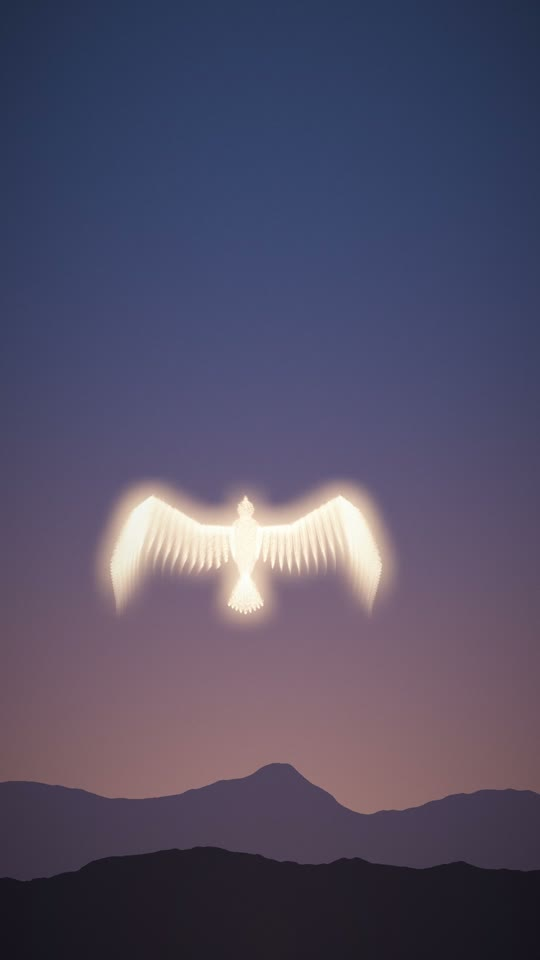
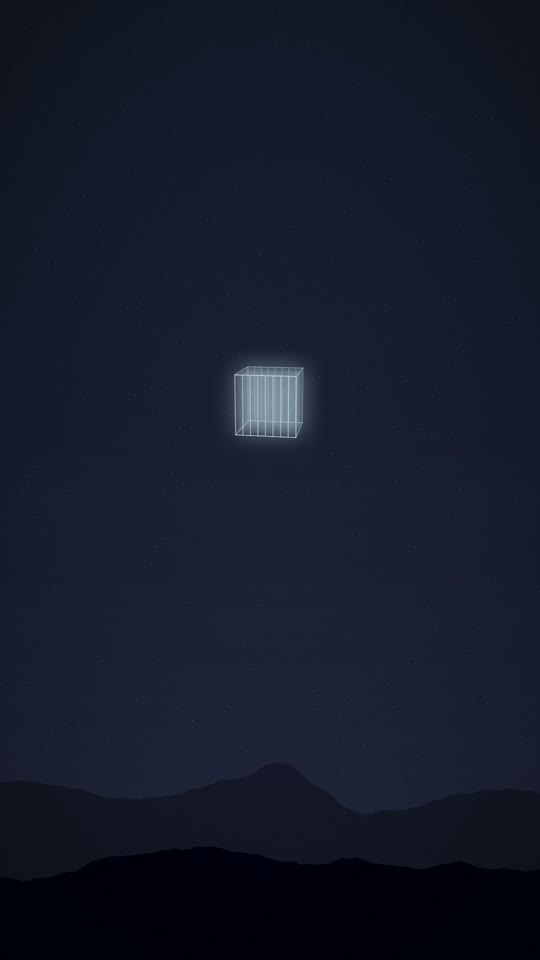
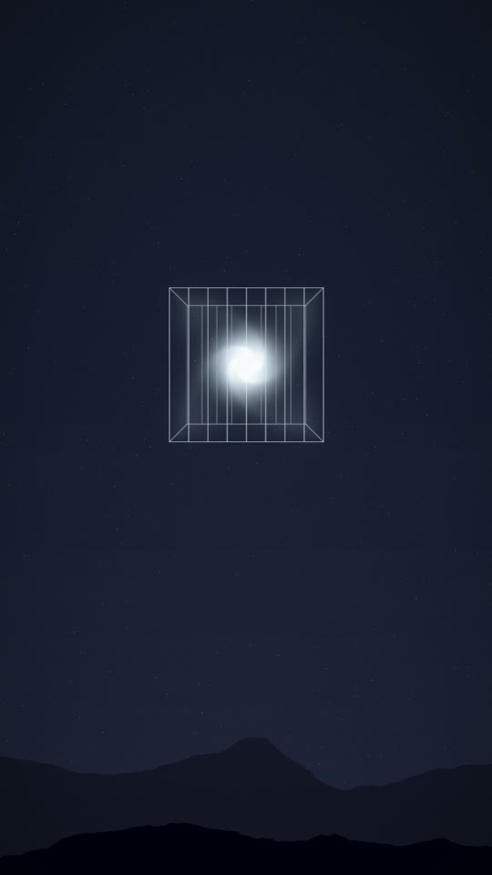
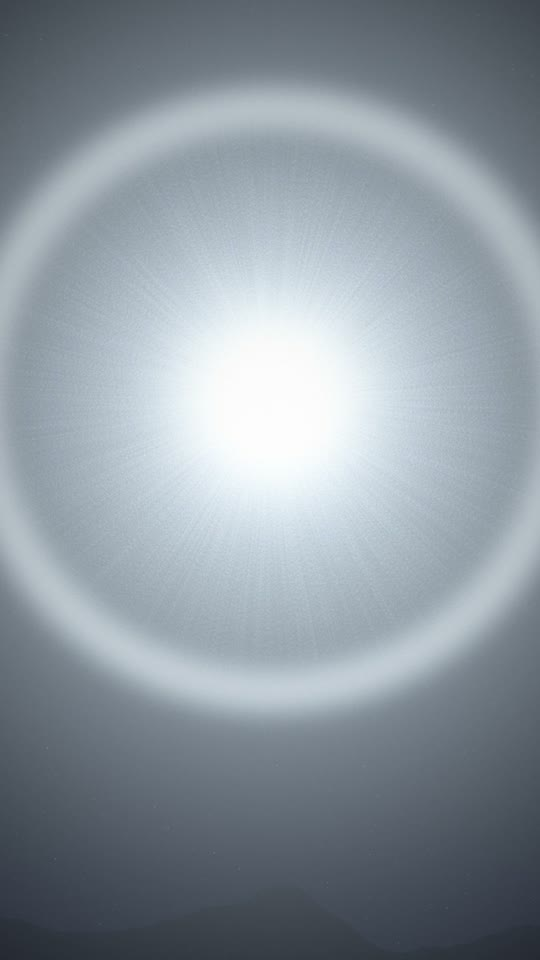
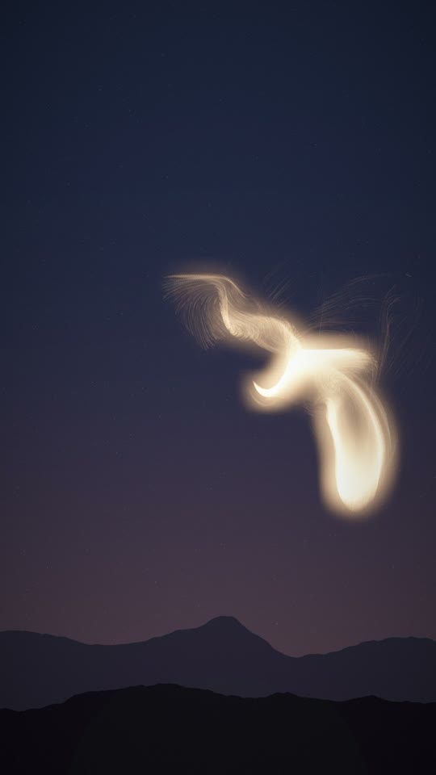
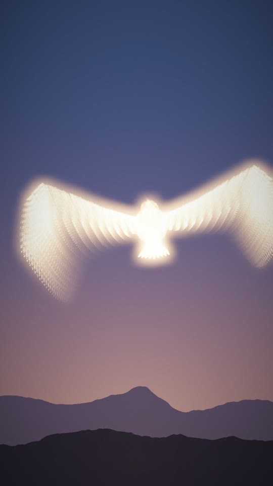
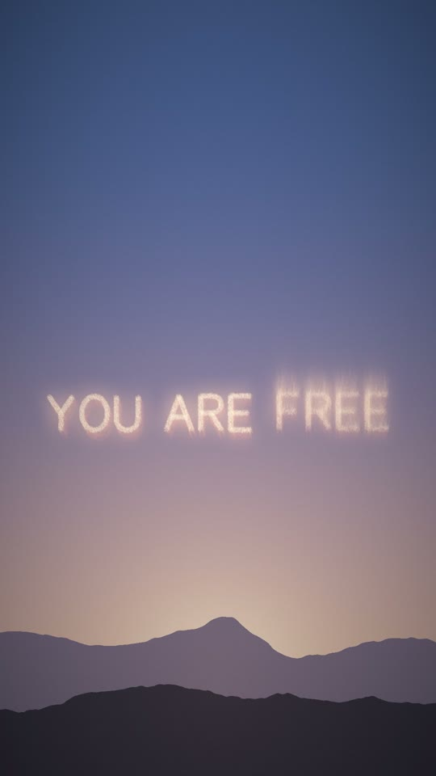
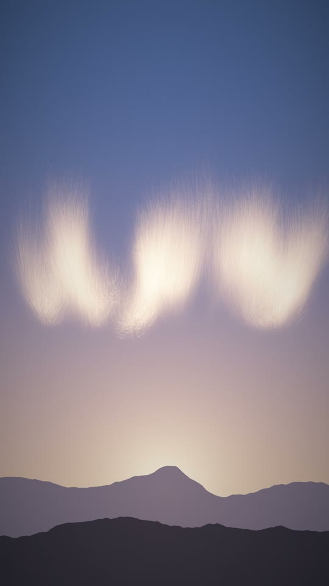

# You are free



A point of light grows a cage around itself, breaks it, and flies. 90,000 points of light are a caged glow, then a
flock, then a phoenix, then three words. **One Node script computes every pixel and every audio sample**; ffmpeg
only encodes them. Nothing here is a physics simulation: the motion is designed by hand, and this page says where.

**Watch:** [on Instagram](https://www.instagram.com/p/DfuoYNoRwqH/), [on YouTube](https://youtube.com/shorts/UckFu8o9mYc), or download it from the [`you-are-free-v1` release](https://github.com/beingcognitive/unreelcode/releases/tag/you-are-free-v1):
64 s, 1080x1920 (9:16), 30 fps, with sound.

<br clear="right">

| | | | |
|---|---|---|---|
|  |  |  |  |
| 0:05 the cage | 0:10 the held breath | 0:11 the burst | 0:21 the flock |
|  |  |  |  |
| 0:34 the phoenix | 0:37 over the camera | 0:46 the words | 0:54 the words rise |

## The film
| Time | What happens |
|---|---|
| 0–9.4 | One point of light in the dark. With each of nine heartbeats a wire cube grows around it, and fills with lights |
| 9.4–11.0 | The lights spiral into a round core. Time slows to a near stop and the sound cuts out for about 1.3 s |
| 11.0 | The burst: one white frame, a shockwave ring, the cage gone |
| 11.0–15.6 | Slow motion, at 6 % speed, while the camera pushes in to about 3× |
| 15.6–17.5 | The camera pulls out as time runs fast to catch up; the music starts |
| 17.5–32 | The lights fly as a flock over the hills while night turns to dawn: they split in two, dive behind the near ridge, and join |
| 32–36.5 | They become a phoenix, which beats its wings, then glides |
| 36.5–38.2 | It banks and flies straight at the camera, passing overhead whole |
| 40–51.5 | Light comes down from above and settles, word by word, into one small line: YOU ARE FREE |
| 51.5–64 | The words rise as flocks into the sunrise. Fade out |

Times are film time. Inside the script most events are written in "story time", which runs 4 s behind film time after
the burst (see *Time* below).

## How it's made
Everything is in [`make_reel.js`](make_reel.js), about 730 lines, with no dependencies beyond Node's standard library.
It writes raw RGB frames to ffmpeg's standard input and a WAV file for the sound.

**The renderer.** A software renderer into floating-point RGB buffers at 1080x1920:
- **points of light, added together.** Each of the 90,000 lights is drawn as three small bilinear splats along its
  path for that frame, into a trail buffer that fades a little every frame. That is what gives motion its streaks.
- **the look.** A bloom (the frame blurred at quarter resolution and added back), a tone curve and gamma from a lookup
  table, a vignette and film grain.
- **the place.** A sky gradient that moves from night to dawn, a sun glow that rises behind the hills, stars that
  fade, and two ridges of hills made from value noise. The near ridge hides the lights, so the flock can pass behind it.
- **the camera** is a zoom and shake applied to the finished frame by resampling it.

**The motion** is hand-designed, in five modes that each light moves between:
- **caged:** a random walk inside the cube, with an outward kick on every heartbeat. The cube is drawn as wire in
  perspective and turns slowly; each light has a fixed depth inside it and is drawn through the same projection.
- **collapse:** a damped spring toward the centre plus a sideways term, so the lights spiral in. A round glow is drawn
  at the centre and brightens through the pause.
- **flock:** each light follows a flow field (the curl of a 3D value-noise function, so the flow has no sources or
  sinks) and is pulled toward one of two centres that move on scripted paths.
- **phoenix:** each light is assigned a place on a rigged bird (below) and held there by a stiff damped spring.
- **words:** each light moves a fixed fraction of the remaining distance to its place every frame, so it is fastest as
  it leaves and slows all the way down.

**The phoenix** is a small rig, not a drawing: a body profile, a tail fan of 9 feathers, and two wings of three bones
each, carrying 12 secondary feathers along the arm and 9 primaries on the hand. The wing beats at 0.8 Hz, with the
downstroke taking 40 % of the cycle and the wing folding on the upstroke. Feather tips follow the bones up to 0.11 s
late, in 16 steps, so the wing bends as it moves. The rig is seen from behind and above (52°) and projected flat; in
the rush the view swings to 9°, the bird's scale grows about ninefold, and the head is enlarged slightly so it leads.

**The letters** come from a stroke font written in the script: eight glyphs (A E F O R U W Y) as line segments and
arcs. Lights are scattered along the strokes; 42 % sit on the front face and the rest along a short extrusion behind
it, tinted amber, which swings slowly so the line reads as solid. One band of light sweeps across it once.

**Time.** The film runs on two clocks. Story time drives the motion; film time is what you watch. Just before the
burst story time slows to 2 % for 1.3 s, and after it to 6 % for about 4 s, then runs up to 2.25× to catch up. Four
seconds are never repaid, so the film is 64 s for 60 s of story. Every change of speed is eased.

**The sound** is synthesised in the same script at 44.1 kHz stereo: a low drone; two thumps per heartbeat; a noise
riser into the collapse; silence; an impact with a sub drop and a thin ringing tone over the slow motion; then pads
(D, B minor, G, A), a plucked arpeggio, bass, a lead melody, a kick and hats, through a ping-pong delay and a soft
clipper. The whole track is scaled so its sample peak is 0.92 of full scale.

**Chosen, not simulated:** all of it. The paths of the flock centres, the timing of every event, the bird's
proportions and wing beat, the shockwave ring, the colours and the music are choices. The springs and the flow field
are tools for making motion look alive, not models of anything real.

**Simplifications:**
- **The lights do not see each other.** A real flock is birds reacting to their neighbours. Here each light follows
  the same field and the same centres, independently.
- **The phoenix is flat-projected.** There is no perspective except the one term on the head, and no shading: where
  feathers overlap, their light simply adds.
- **The camera zoom enlarges a finished frame,** so at its deepest (about 3×) the picture is softer than the rest.
- **The cage's bars do not break.** They disappear behind the white frame.

## Build
Node.js and ffmpeg on PATH; nothing to install. Built with Node 26.7.0 and ffmpeg 9.0.1 on macOS (Apple M3 Pro).
Run from this folder.
```
node make_reel.js                                # we-are-free-vertical.mp4, about 8 minutes
node make_reel.js --test 10.8,34,46 out/stills   # PNG stills at those film times (the folder must exist)
python credits.py we-are-free-vertical.mp4 you-are-free.mp4   # the posted file: the film plus end credits
```
The script simulates every frame from the start to reach a still, so a late still takes almost as long as the film.
Encoding is libx264 (`-preset slow -crf 18`) and AAC at 192 kb/s.

**The end credits** are the one part not drawn by the script. [`credits.py`](credits.py) (Python with Pillow, the Avenir
Next system font) lays three lines of text over the empty sky from 56.5 s to 63 s and re-encodes the picture
(`-crf 15`); the sound is copied unchanged. The posted and released file is that copy, 90.8 MB.

Two earlier endings are still in the script, unused: `--ending-a` (the flock recedes to one point on the horizon, 52.8 s)
and `--big-title` (the words as three large stacked lines).

## Measured
All from the script's output, before the credits are added, with ffprobe and ffmpeg:
- **Duration** 64.000 s, 1,920 frames, H.264 + AAC, 64.9 MB.
- **Loudness:** integrated −16.4 LUFS, loudness range 5.6 LU, true peak −0.2 dBFS, after AAC encoding (ffmpeg ebur128).
- **The pause is silent:** peak −91 dB from 9.6 s to 10.8 s (volumedetect).
- **The hit:** peak −0.3 dB in the 0.6 s from 10.9 s.
- **Reproducible:** run again from a copy of this folder, the script gave a byte-identical MP4 (same SHA-256,
  `f0102695…e88186`), on the same machine with the same Node and ffmpeg. Render time for that run: 8 min 8 s.

## Known flaws
- **The hit at 11 s is nearly at full scale** (true peak −0.2 dBFS). It is not mastered to a loudness target, and a
  platform's re-encode could clip it.
- **Claude has not watched it move or heard it.** The picture was checked through extracted stills and the sound
  through level measurements only. The director watched every cut and approved this one.
- **The font has eight letters,** only the ones this title needs.
- **About a second of empty sky** follows the phoenix's pass before the light comes down.
- **File and folder names still say `we-are-free`,** the working title until the last cut.

## Versions
The director's notes shaped every cut; these are the main turns.
- **First film:** 26 s, landscape, the title on one line.
- **Reel:** 60 s, vertical. The burst gained a held breath, slow motion and a camera move; the bird went from two
  flat fans to the feathered rig, after the wing tips were called mechanical.
- **Tried and removed:** glitter pouring over the camera; the phoenix returning to breathe out the words; debris from
  the cage; a zoom in stepped stages; a sphere at the centre of the collapse.
- **This cut** (15 Nov): the cage grows from a point; the pause sits before the burst; one eased zoom; the phoenix
  passes overhead whole; the title became one small line and its words changed from WE ARE FREE to YOU ARE FREE.

---
Made by Claude Code, Fable 5.2 · directed by being.cognitive. Part of [unreel()](../): films written in code, not filmed.
